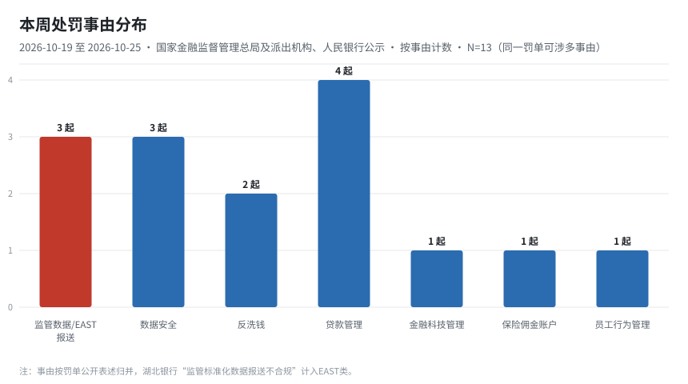
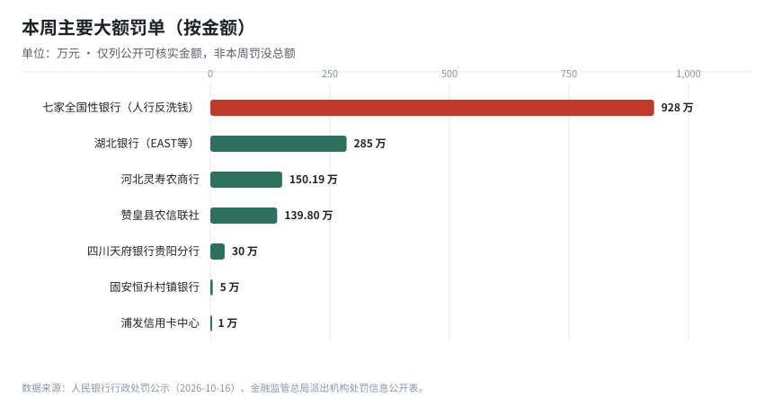
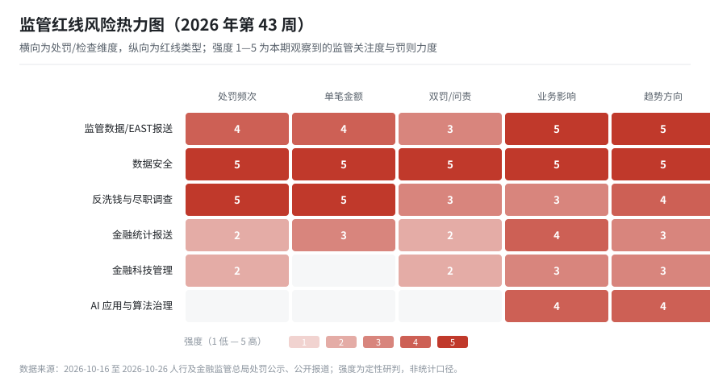
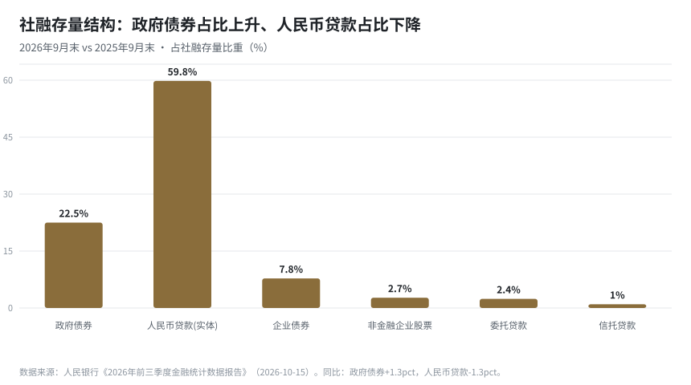

# 金融监管信息周报（2026 年第 43 周）

> **报告期间**：2026-10-19（周一）— 2026-10-25（周日）｜**生成**：2026-10-26 09:00（Asia/Shanghai）
> **读者**：监管报送业务、系统需求/开发、行领导、金融市场发展、合规管理
> **版本说明**：本报告按角色分层：先给结论和动作，再给口径和清单，事实与判断严格分区；年度处罚趋势见 [2026-ytd-penalty-trend.md](/regwatch/weekly/2026-ytd-penalty-trend)。

---

## 0. 一页纸（给领导的 90 秒版）

**结论**：本周监管有两条同时收紧的线——**“AI+金融”治理前置**（论坛定调 + 地方发文 + 机构制度落地）与**报送/数据类处罚实质化**（EAST 独立罚点、数据安全双罚、金融统计违规入罚）。监管处罚的“事由结构”正从信贷业务向**数据与报送**迁移。

**本周必须知道的 3 个动作**

1. **报送条线**：启动一表通 2.1 → EAST5.0 映射差异分析（62 表 / 1,498 字段），并搭建“新旧 EAST 对比”工具；同步核对 1104 新增 G01_Ⅵ 托管业务表与“五篇大文章”口径边界。
2. **科技条线**：把“AI 治理制度”（模型清单、算法备案、人工复核、可解释性留痕）列入四季度需求池，避免等检查再补。
3. **合规条线**：将“监管数据报送真实性”“数据安全”“金融统计报送”三条纳入季度自查清单，因为三者本周均有**独立处罚先例**。

**3 个风险**

- 报送口径变更与系统改造若不同步，**跨表校验失败**将直接暴露为“数据报送不合规”。
- AI 应用若缺少人在环路与可解释留痕，一旦发生投诉/损失，**定性会从“技术问题”升级为“治理问题”**。
- 地方数字金融试点（AI 面客、沙盒）可能产生**新业务、旧口径**的统计归属争议。

**3 个月关键时点**：2026Q4 一表通 2.1 试点验收 → 2026 年报（1104 新口径首次全年填报）→ 2027Q1 机构 AI 治理制度集中出台窗口。

---

## 0.5 合规日历（未来 120 天，由 `data/compliance-calendar.csv` 生成）

| 日期 | 剩余天数 | 类型 | 业务线 | 事项 | 牵头部门 | 状态 |
|---|---|---|---|---|---|---|
| 2026-11-15 | 20 | 月度 | 1104 | 2026 年 10 月 1104 非现场监管报表（含新增 G01_Ⅵ 托管… | 报送 | 待确认 |
| 2026-11-15 | 20 | 月度 | EAST | EAST 明细数据月报（非银机构按月，银行按现行频度） | 报送 | 待确认 |
| 2026-11-20 | 25 | 月度 | 一表通 | 一表通 2.1 试点数据报送（试点机构） | 报送 | 试点跟踪 |
| 2026-12-15 | 50 | 月度 | 人行统计 | 金融统计数据报送（社融、M0/M1/M2、存贷款） | 财务 | 待确认 |
| 2026-12-31 | 66 | 年度 | 记账 | 2026 年度账务结转与 2027 年科目初始化 | 财务 | 计划 |

> 时点中标注“待确认”的以监管正式通知为准；如需调整提醒提前量，改 CSV 的“提前提醒天数”列。

---

## 1. 按角色阅读路径

| 角色 | 先读 | 再读 | 可跳过 | 建议时长 |
|---|---|---|---|---|
| 行领导 | §0 一页纸、§2 监管方向 | §6 红线、§7 市场 | §3—§5 细节表格 | 5 分钟 |
| 监管报送业务 | §3 报送变更矩阵、§3.2 处罚点 | §5 需求清单、§8 事实表 | §7 市场 | 10 分钟 |
| 系统需求/开发 | §5 系统影响、§3 变更矩阵 | §6 红线（校验规则来源） | §2、§7 | 10 分钟 |
| 合规管理 | §6 红线清单、§3.2 处罚点 | §3 变更矩阵、§5 控制点 | §7 市场 | 10 分钟 |
| 金融市场发展 | §7 市场与业务、§2 方向 | §6 红线（业务边界） | §3—§5 技术细节 | 8 分钟 |

> 设计原则：**同一事实只出现一次**（集中在 §8），各角色章节只写“与我有关的部分 + 动作”，避免五类读者读同一段长文。

---

## 2. 监管方向：鼓励什么、限制什么

### 2.1 鼓励方向（可做、应做）

| 方向 | 本周依据 | 对业务/系统的含义 |
|---|---|---|
| AI 与金融双向赋能 | 人行潘功胜：金融支持 AI 产业、稳妥推进 AI 应用；朱鹤新：“十五五”智能驱动 | AI 信贷、智能风控、智能核赔场景可推进，但需治理配套 |
| 数据要素价值释放 | 朱鹤新“数据筑基”；上海 22 号文推隐私计算、区块链 | 数据平台、隐私计算、数据资产入表相关需求将增加 |
| 地方数字金融试点 | 上海 22 号文、北京“AI 面客”试点、监管沙盒 | 试点业务需提前设计**统计口径与留痕**，否则报送端返工 |
| 普惠/养老/科技/绿色/数字“五篇大文章” | 1104 明确 S68/S70/S73/S74/S75 口径 | 贷款投向标识要能“打得上、说得清”，直接影响报表 |
| 托管等“后台”业务透明化 | 1104 新增 G01_Ⅵ 托管业务表 | 托管系统需补齐账户、头寸、赎回缓冲等明细字段 |

### 2.2 限制与红线（不能碰）

| 红线 | 本周依据 | 性质 |
|---|---|---|
| 监管数据报送不真实、不完整、不合规 | 湖北银行 285 万元（EAST）；邮储/广发 10 项违法含“违反金融统计管理规定” | 行政处罚，可单独立案 |
| 数据安全失守（含双罚到人） | 灵寿、赞皇“违反数据安全管理规定”双罚；4 人中被罚者仅 1 人来自科技部门 | 行政处罚 + 个人问责 |
| 反洗钱义务缺失 | 七家银行 928 万元 + 邮储/广发千万级，事由集中在客户身份识别、可疑交易报告 | 高频率、高金额 |
| AI 应用“无治理、无人在环路” | 肖远企：健全治理框架、坚持人在环路、确保智能向善 | 监管导向 → 预计转为检查项 |
| 以“技术外包”规避科技治理责任 | 村镇银行因“违反金融科技管理规定”被罚并双罚行长 | 机构主体责任不外包 |

**方向判断**：监管并非“限制 AI”，而是**把 AI 纳入与传统风险同等级别的治理框架**；同时把“数据”从“技术资产”提升为“监管证据”。对机构而言，**报送质量 = 数据治理水平 = 合规能力**，三者正在被同一套检查逻辑串起来。

---

## 3. 监管报送：变更矩阵与处罚点（报送业务主读）

### 3.1 变更矩阵（制度 → 报表/字段 → 系统 → 时点）

| 制度/口径 | 涉及报表/字段 | 系统影响 | 关键时点 | 优先级 |
|---|---|---|---|---|
| 1104 2026 制度（金发〔2025〕40 号） | 新增 G01_Ⅵ 托管业务表；修订 13 张表；新增指标 43、调整 46、删除 4；机构类新增 4 表、修订 12 表 | 报表引擎新增表样、取数逻辑、校验规则；机构类型分支 | 2026 年报首次全年填报 | P0 |
| 五篇大文章口径明确 | G01_Ⅶ（高技术/数字经济/知识产权仅单位贷款）；S70、S74 仅单位贷款；S68、S73、S75 可含个人；S73/S74 不含买断式转贴现 | 贷款投向标识、单位/个人拆分、转贴现剔除规则 | 随 1104 2026 制度 | P0 |
| 一表通 2.1 | 新增 154 字段、优化近 600 数据项、近 200 字段改文本；62 表/1,498 字段映射至 EAST5.0 | 监管集市新增 2.1 数据区；2.0/2.1 并存；新增转换与对比工具 | 试点验收（Q4 起） | P0 |
| EAST 2.0（非银） | 季度 → 月度；明细扩充；历史数据全量补报 | 报送频次调度、历史数据回溯、跨表一致性 | 消金历史补报节点 2026-04-25（已过）；非银按月常态化 | P1 |
| EAST 5.0 校验 | 主键完整度、字段数值匹配度、规则校验通过率 | 质量规则库、比对报表、问题闭环 | 与一表通 2.1 同步 | P0 |
| 人行金融统计口径 | M1 新口径（含个人活期、备付金）；社融分项结构 | 统计指标字典、M1/M2 取数逻辑 | 按月 | P1 |

> 说明：一表通 2.1 与 1104 2026 制度均为**已发布**；EAST 2.0 非银为**已实施、按月常态化**；上述时点以监管正式通知为准，本表用于排期参考。

### 3.2 本周处罚点（按“罚点—证据—控制点”拆解）

| 罚点 | 处罚案例 | 监管取证方式（推断） | 应建的内部控制点 |
|---|---|---|---|
| EAST/监管数据报送不合规 | 湖北银行 285 万元 | 现场检查抽取明细，与 1104 汇总、业务台账交叉比对 | 报送前“明细—汇总—台账”三方对账；差异留痕 |
| 违反金融统计管理规定 | 邮储、广发（10 项违法之一） | 统计报表与源系统、会计科目比对 | 统计口径字典 + 科目映射表版本管理 |
| 数据安全违规（双罚） | 灵寿 150.19 万、赞皇 139.8 万 | 检查数据分级、权限、脱敏、日志 | 数据分类分级、最小权限、操作留痕、外包管控 |
| 反洗钱义务缺失 | 七家银行 928 万；邮储/广发千万级 | 客户身份识别、可疑交易报告抽查 | KYC 完整性、可疑交易模型有效性验证 |
| 金融科技管理违规 | 固安恒升村镇银行 5 万 + 行长 1.5 万 | 科技治理、外包、系统管理检查 | 科技治理架构、外包风险评估、变更管理 |

**关键洞察**：湖北银行一案把“业务违规 + 数据报送违规”写进同一张罚单，说明监管已把**数据一致性当作业务真实性的验证手段**。报送不再是“后台作业”，而是**业务合规的取证环节**。

---

## 4. 报送处罚趋势（本期起建立基线）

本周（10-19—10-25）公开可核实的报送/数据相关罚单**明显放量**：邮储 1,743.3 万元、广发 1,712.4 万元（均含金融统计/反洗钱等 10 项违法），叠加湖北银行 EAST 285 万元、灵寿/赞皇数据安全双罚。**“千万级罚单 + 双罚到人”已成为报送与数据条线的现实风险量级。**

为避免“看图说话”，本期不绘制跨周趋势线，改为建立**周度基线表**，从下一期起累计 8 周后出趋势图。**年度视角见 [《2026 年报送与数据类处罚趋势（1—10 月）》](/regwatch/weekly/2026-ytd-penalty-trend)**：1—5 月数据报送与治理类罚单 346 张（同比 2.5 倍），9—10 月转向千万级大额罚单，报送不合规已可单独立案。

| 周次 | 期间 | 报送/数据类处罚单数 | 涉及机构数 | 已知最大单笔（万元） | 备注 |
|---|---|---|---|---|---|
| W43 | 10-19—10-25 | 8 单 | 13 家 | 1,743.3（邮储） | 本期基线；7 家同批次计 1 单 |
| W44 | 10-26—11-01 | 待采集 | 待采集 | 待采集 | 下期填充 |

> 计数口径：**处罚单口径**（同一批次多机构计 1 单），同时在备注保留机构数，避免“数单”与“数机构”混用。

> 基线表存放于 `data/penalty-baseline.csv`，每期追加一行，季度出趋势。

---

## 5. 系统与需求影响（需求/开发主读）

### 5.1 影响面清单

| 影响对象 | 变更内容 | 需求类型 | 建议排期 |
|---|---|---|---|
| 监管集市 | 一表通 2.1 数据区（新增 154 字段、近 600 项调整） | 数据模型 + ETL | Q4 立项，试点前完成 |
| 报送区 | 2.0/2.1 双轨并存；2.1 → EAST5.0 转换 | 转换程序 + 调度 | 与集市同步 |
| 报表平台 | 1104 新增/修订表样、校验规则、机构分支 | 配置 + 规则引擎 | 年报前 1 个月冻结 |
| 质量工具 | 新旧 EAST 对比（主键完整度/字段一致性/校验通过率） | 比对报表 + 告警 | 与转换程序同批 |
| 贷款投向 | 五篇大文章标识、单位/个人拆分、转贴现剔除 | 打标 + 取数 | 随 1104 |
| 统计指标 | M1 新口径、社融分项 | 指标字典 + 取数 | 按月迭代 |
| AI 治理 | 模型清单、算法备案、人工复核、可解释留痕 | 治理平台/流程 | Q4 需求池，2027Q1 前上线 |
| 数据安全 | 分类分级、权限、脱敏、日志 | 安全能力 | 与数据治理项目合并 |

### 5.2 需求文档必须写清的 5 件事（来自罚单教训）

1. **数据来源与口径**：字段取自哪个源系统、哪个科目、什么时点，口径变更谁审批。
2. **校验规则与容错**：主键唯一、跨表一致、码值合法；失败是阻断还是告警，谁处理。
3. **留痕与可追溯**：加工链路、版本、修改记录，能否回答“这个数怎么来的”。
4. **双轨与回退**：2.0/2.1 并存期如何切换、如何比对、如何回退。
5. **责任边界**：外包做什么、机构自己做什么，科技治理责任不得外包。

### 5.3 报送变更台账（累计台账，由 `data/reg-change-ledger.csv` 生成）

| 变更编号 | 来源制度 | 变更类型 | 影响报表 | 优先级 | 牵头 | 状态 | 目标日期 |
|---|---|---|---|---|---|---|---|
| RC-2026-043-01 | 一表通 2.1 | 口径调整 | 一表通全表；EAST5.0 转换结果 | P0 | 报送 | 评估中 | 2026-12-31 |
| RC-2026-043-02 | 1104 2026 制度 | 新增报表 | G01_Ⅵ 托管业务情况表 | P0 | 报送 | 评估中 | 2026-12-31 |
| RC-2026-043-03 | 1104 2026 制度 | 口径调整 | G01_Ⅶ、S68、S70、S73、S… | P0 | 报送 | 评估中 | 2026-12-31 |
| RC-2026-043-05 | 人行金融统计 | 口径调整 | 金融统计报表 | P1 | 财务 | 已实施 | 2025-01-01 |
| RC-2026-043-04 | EAST 2.0（非银） | 频度调整 | EAST 非银报表 | P1 | 报送 | 已实施 | 2026-04-25 |

- 在办 3 项，其中 P0 3 项；已上线/已实施 2 项。
- P0 待办：RC-2026-043-01 一表通 2.1；RC-2026-043-02 1104 2026 制度；RC-2026-043-03 1104 2026 制度

> 台账按“变更编号”跨期累计，状态取值为待评估/评估中/已立项/开发中/测试中/已上线/已实施/暂缓；每周用 `python3 tools/regdata.py set` 更新状态，避免每期重做一张孤立表格。

---

## 6. 合规：红线清单与检查对照（合规主读）

### 6.1 红线清单（一票否决项）

| # | 红线 | 判定要点 | 本周先例 | 自查频率 |
|---|---|---|---|---|
| 1 | 报送数据不真实 | 明细与汇总、台账不一致；人为调节 | 湖北银行 | 月 |
| 2 | 报送不及时/漏报 | 迟报、漏表、漏字段 | 邮储/广发（金融统计） | 月 |
| 3 | 数据安全失守 | 未分级、越权访问、未脱敏、日志缺失 | 灵寿、赞皇（双罚） | 季 |
| 4 | 反洗钱义务缺失 | 客户身份识别、可疑交易报告 | 七家银行、邮储/广发 | 月 |
| 5 | 科技治理缺位 | 外包无评估、变更无审批、系统无预案 | 固安恒升 | 半年 |
| 6 | AI 应用无治理 | 无制度、无人在环路、无解释留痕 | 论坛定调（导向） | 季 |

### 6.2 检查对照表（把罚单变成自查题）

| 检查项 | 自查问题 | 证据材料 | 责任部门 |
|---|---|---|---|
| 报送一致性 | 同一指标在 EAST、1104、一表通中是否一致？差异是否有说明？ | 对账报告、差异台账 | 报送 + 数据 |
| 统计口径 | 统计科目与源系统映射是否有版本记录？ | 口径字典、变更记录 | 财务 + 报送 |
| 数据安全 | 敏感数据是否分级、权限是否最小化、是否留痕？ | 分级清单、权限矩阵、日志 | 科技 + 合规 |
| 双罚风险 | 关键岗位是否明确数据/报送责任？ | 岗位责任书、问责记录 | 人力 + 合规 |
| AI 治理 | 模型是否备案、是否有复核人、是否可解释？ | 模型清单、复核记录 | 科技 + 合规 |

### 6.3 红线热力图

> 读法：颜色越深表示本周监管关注度/罚则力度越高。**数据安全、报送、反洗钱**三行接近满格，是当前资源投入优先级；AI 治理行目前“频次低、趋势高”，属于**提前布局项**。

---

## 7. 金融市场与业务发展（市场/业务主读）

### 7.1 关键数据（2026 年前三季度）

| 指标 | 数值 | 同比/结构 | 业务含义 |
|---|---|---|---|
| 社融存量 | 468.17 万亿元 | +7.1% | 总量扩张放缓 |
| 人民币贷款（实体） | 279.9 万亿元 | +4.8%，占比 59.8%（-1.3pct） | 信贷需求偏弱 |
| 政府债券 | 105.23 万亿元 | +13.7%，占比 22.5%（+1.3pct） | 政府相关资产配置上升 |
| 企业债券 | 36.62 万亿元 | +9.3%，占比 7.8%（+0.1pct） | 直接融资替代 |
| 前三季度社融增量 | 27.46 万亿元 | 同比少 2.63 万亿元 | 信用扩张节奏放缓 |
| M2 / M1 / M0 | +7.2% / +3.2% / +10.6% | M1-M2 剪刀差 -4.0pct | 资金活化偏弱 |

### 7.2 对业务方向的 3 点判断

1. **资产端向“政府 + 直接融资”倾斜**：政府债券占比升至 22.5%，对公业务中政府相关项目、债券承销/投资的重要性上升；同时**贷款投向统计**（五篇大文章）成为监管观察业务结构的窗口。
2. **零售信贷承压**：住户贷款前三季度净减少 1.03 万亿元，零售条线需更依赖**场景化与 AI 风控**，但 AI 应用要满足治理要求（人在环路、可解释）。
3. **跨境与代币化是增量试验田**：稳定币/代币化基金（汇丰 RedCoin）、跨境 AI 服务（广西农商）在境外先行，境内机构应关注**统计归属与合规边界**，不宜盲目跟进。

### 7.3 业务红线（市场条线尤其注意）

- 不得以“创新”名义绕开**贷款投向标识**与**统计口径**；
- 试点业务（AI 面客、沙盒）上线前必须明确**数据留痕与报送方案**；
- 涉及稳定币、代币化资产的跨境业务，先确认**外汇与统计口径**再谈落地。

---

## 8. 事实底表（所有信息集中于此，供核对）

### 8.1 制度与会议

| 日期 | 主体 | 事项 | 要点 |
|---|---|---|---|
| 10-19 | 人民银行 | 潘功胜金融街论坛演讲 | 跟踪 AI 宏观影响、金融支持 AI 产业、稳妥推进 AI 应用；“人工智能+金融”政策文件已出台 |
| 10-19 | 金融监管总局 | 丁向群论坛致辞 | 加快数字化智能化转型，完善数字金融等新兴领域监管标准 |
| 10-20 | 人行/总局/证监会/北京市 | 金融科技大会 | 朱鹤新提“十五五”四方面工作；肖远企强调 AI 治理框架、人在环路、智能向善 |
| 10-22 | 上海四部门 | 数字金融“22 号文” | 智能营销/信贷/核赔/风控场景；隐私计算、区块链、物联网 |
| 10-22 | 北京四部门 | 金融营商环境方案 | 优化贷款审批，探索“AI 面客”试点 |
| 10 月 | 金融监管总局 | 《财产保险公司保险产品开发管理规定》 | 八类负面清单，全链条监管 |

### 8.2 处罚（公开可核实部分）

| 日期 | 机构 | 事由 | 金额 | 备注 |
|---|---|---|---|---|
| 10-16 公示 | 工行、农行、中行、建行、光大、华夏、兴业 | 反洗钱（客户身份识别等） | 合计 928 万元 | 19 名责任人另罚 56.5 万元 |
| 10-23 | 邮储银行 | 10 项违法，含未按规定报送大额/可疑交易报告、违反金融统计管理规定 | 罚 1,743.3 万元 | 另没收违法所得 290.2 元 |
| 10-23 | 广发银行 | 10 项违法 | 罚 1,712.4 万元 | 另没收违法所得 1.62 万元 |
| 10-22 | 湖北银行 | EAST 数据报送不合规 + 贷款/银承/债权投资管理不尽职 | 285 万元 | 报送独立罚点 |
| 10-12 公示 | 河北灵寿农商行 | 7 项，含违反数据安全管理规定 | 150.19 万元 | 2 人双罚（各 2 万元） |
| 10-12 公示 | 赞皇县农信联社 | 6 项，含违反数据安全管理规定 | 139.8 万元 | 2 人双罚（各 1 万元） |
| 10-20 公示 | 四川天府银行贵阳分行 | 贷款管理不到位 | 30 万元 | 行长助理警告 |
| 近日 | 固安恒升村镇银行 | 违反金融科技管理规定 | 5 万元 | 行长另罚 1.5 万元 |
| 10-23 公示 | 浦发信用卡中心 | 未开立独立保险佣金收取账户 | 1 万元 | 责任人另罚 1 万元 |

### 8.3 金融科技与报送制度

| 事项 | 要点 |
|---|---|
| 汇丰 RedCoin | 10-23 港元稳定币上线 PayMe，330 万用户、10 万商户 |
| 平安银行《人工智能管理办法》 | 董事会审议通过，对应总局 AI 安全开发应用指导意见 |
| 1104 2026 制度 | 新增 G01_Ⅵ 托管表；新增指标 43、调整 46、删除 4；机构类新增 4 表 |
| 一表通 2.1 | 新增 154 字段；62 表/1,498 字段映射 EAST5.0；2.0/2.1 并存 |
| EAST 2.0 | 非银按月报送；消费金融历史数据补报节点 2026-04-25 |

> 说明：10-12 公示的灵寿/赞皇罚单由 10-26 报道披露，属“公示日早于本周、披露在本周”的情形，已在表中标注日期，避免与“本周处罚”混淆。

---

## 9. 行动清单（按优先级与责任）

| 优先级 | 事项 | 牵头 | 配合 | 时限 |
|---|---|---|---|---|
| P0 | 一表通 2.1 → EAST5.0 映射差异分析与对比工具 | 报送 | 数据/科技 | Q4 |
| P0 | 1104 2026 新表与五篇大文章口径核对 | 报送 | 财务/科技 | 年报前 |
| P0 | 报送一致性三方对账（明细-汇总-台账） | 报送 | 数据 | 月度 |
| P1 | 数据安全分类分级与双罚风险排查 | 科技 | 合规/人力 | 季度 |
| P1 | AI 治理制度（模型清单/复核/留痕） | 科技 | 合规 | 2027Q1 前 |
| P2 | 处罚基线表与 8 周趋势 | 报送 | — | 每周 |
| P2 | 地方数字金融试点跟踪（AI 面客/沙盒） | 市场 | 合规 | 持续 |

---

## 10. 信息来源

- 移动支付网《【一周观察】潘功胜谈AI…》（2026-10-26）：<https://www.mpaypass.com.cn/news/202610/26091359.html>
- 中国网财经《央行等多部门监管发声 金融科技抢抓AI发展机遇》（2026-10-22）：<http://finance.china.com.cn/money/20261022/6326494.shtml>
- 人民银行《2026年前三季度金融统计数据报告》（2026-10-15）：<https://jrj.sh.gov.cn/SCGK194/20261015/24a15f78c09947de9eb58a48c2fdb451.html>
- 中国青年网《中国人民银行开出多张罚单 邮储、广发被罚超千万》（2026-10-23）：<http://finance.youth.cn/finance_gdxw/202610/t20261023_16929319.htm>
- 移动支付网《2家银行因数据安全问题被“双罚”》（2026-10-26）：<https://www.mpaypass.com.cn/news/202610/26090751.html>
- 宇信科技《2026年1104非现场监管制度升级解读》：<https://www.bsia.org.cn/site/content/31528.html>
- 宇信科技《一表通2.1试行，“统一报送”迈出实质一步》：<https://www.sohu.com/a/1040547394_122014422>
- 亿信华辰《EAST2.0全面落地：非银机构应对》：<https://www.esensoft.com/industry-news/data-governance-59752.html>
- 中国经济网《浦发银行信用卡中心被罚》（2026-10-26）：<http://finance.ce.cn/bank12/scroll/202610/t20261026_3271712.shtml>
- 中国经济网《四川天府银行贵阳分行被罚》（2026-10-21）：<http://finance.ce.cn/bank12/scroll/202610/t20261021_3266427.shtml>

---

*本报告由自动化任务生成。事实以公开来源为准，处罚金额与事由以监管公示原文为最终依据；强度评级与方向判断为分析观点，不构成合规结论。*
