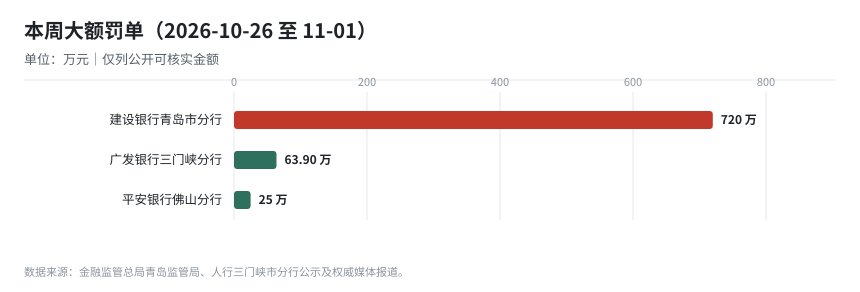
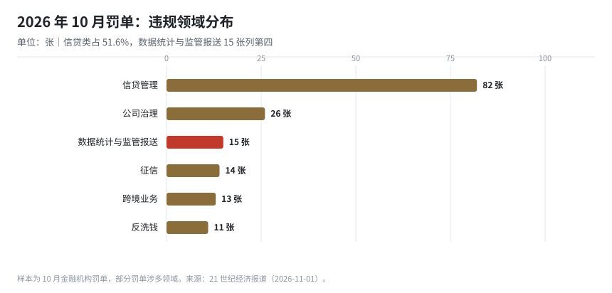
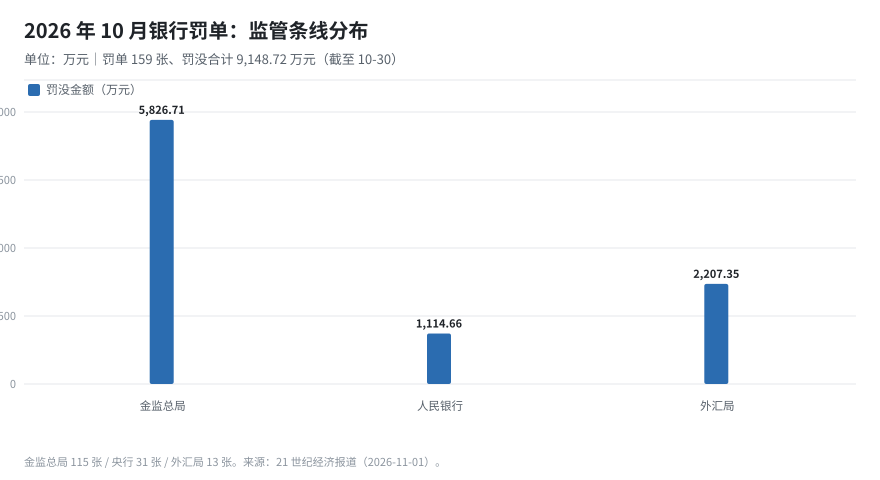
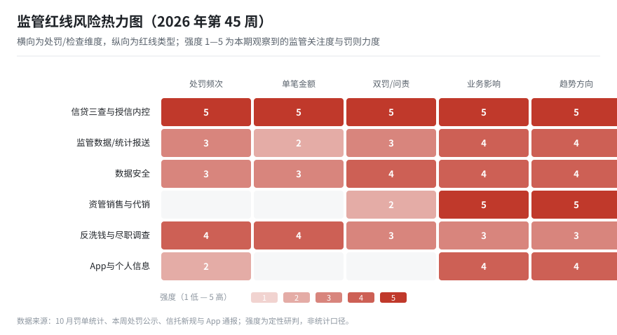

# 金融监管信息周报（2026 年第 45 周）

> **报告期间**：2026-10-26（周一）— 2026-11-01（周日）｜**生成**：2026-11-02 09:00（Asia/Shanghai）
> **读者**：监管报送业务、系统需求/开发、行领导、金融市场发展、合规管理
> **本期焦点**：《资产管理信托管理办法》发布 / 10 月罚单“量降额稳、问责加重” / 1104 月报进入 13 天倒计时｜年度趋势见 [2026-ytd-penalty-trend](/regwatch/weekly/2026-ytd-penalty-trend)

---

## 0. 一页纸（给领导的 90 秒版）

**结论**：本周监管呈现“**制度补短板 + 执法转重点**”的组合：信托资管补上 19 年来的专门规章，10 月罚单数量和金额环比双降但**双罚率升至 63.2%、禁业最长 12 年**，说明监管从“批量覆盖”转向“精准打人”，数据统计与监管报送仍是独立罚点（10 月 15 张）。

**本周必须知道的 3 个动作**

1. **报送条线**：11-15 前完成 10 月 1104 与 EAST 月报，重点核对 G01_Ⅵ 托管表与“五篇大文章”口径（见 §0.5，仅剩 13 天）。
2. **合规条线**：把“贷款三查 + 授信内控”与“数据统计报送”并列为 Q4 自查重点——建行青岛 720 万元、广发三门峡 63.9 万元的罚点，分别代表这两条线。
3. **业务条线**：若涉及信托代销或资管产品，立即核对《资产管理信托管理办法》的代销机构范围与“不得承诺保本保收益”要求。

**3 个风险**

- 年末考核与报送高峰叠加，**迟报、错报**风险上升，而“数据统计与监管报送”已是独立处罚类别。
- 双罚与禁业常态化，**责任落到具体岗位**，仅靠机构层面整改无法覆盖个人问责风险。
- 信托新规“新老划断”整改期，**存量产品压降与代销合规**若处理不当，会同时触发监管与客户投诉。

**3 个月关键时点**：2026-11-15 报送月报 → 2026-12-31 年度账务结转 → 2027-03-31 1104 年报（新口径首次全年填报）。

---

## 0.5 合规日历（未来 120 天）

| 日期 | 剩余天数 | 类型 | 业务线 | 事项 | 牵头部门 | 状态 |
|---|---|---|---|---|---|---|
| 2026-11-15 | 13 | 月度 | 1104 | 2026 年 10 月 1104 非现场监管报表（含新增 G01_Ⅵ 托管业务表） | 报送 | 待确认 |
| 2026-11-15 | 13 | 月度 | EAST | EAST 明细数据月报（非银机构按月，银行按现行频度） | 报送 | 待确认 |
| 2026-11-20 | 18 | 月度 | 一表通 | 一表通 2.1 试点数据报送（试点机构） | 报送 | 试点跟踪 |
| 2026-12-15 | 43 | 月度 | 人行统计 | 金融统计数据报送（社融、M0/M1/M2、存贷款） | 财务 | 待确认 |
| 2026-12-31 | 59 | 年度 | 记账 | 2026 年度账务结转与 2027 年科目初始化 | 财务 | 计划 |

> 时点标注“待确认”的以监管正式通知为准。**11-15 两项仅剩 13 天，本周应完成数据准备与首轮校验。**

---

## 1. 按角色阅读路径

| 角色 | 先读 | 再读 | 可跳过 | 建议时长 |
|---|---|---|---|---|
| 行领导 | §0、§2 | §6、§7 | §3—§5 | 5 分钟 |
| 监管报送业务 | §0.5、§3 | §5、§8 | §7 | 10 分钟 |
| 系统需求/开发 | §5、§3 | §6 | §2、§7 | 10 分钟 |
| 合规管理 | §6、§3.2 | §0.5、§5 | §7 | 10 分钟 |
| 金融市场发展 | §7、§2 | §6 | §3—§5 | 8 分钟 |

---

## 2. 监管方向：鼓励什么、限制什么

### 2.1 鼓励方向

| 方向 | 本期依据 | 对业务/系统的含义 |
|---|---|---|
| 信托资管回归本源 | 《资产管理信托管理办法》强调主动管理、组合投资、净值化 | 通道、资金池业务被明确禁止，主动管理能力成为核心竞争力 |
| 资本市场工具使用 | 11-02 人行、金监总局、证监会召集银行研究优化股票回购增持再贷款 | 相关贷款产品与统计口径需同步跟进 |
| 数字人民币与支付基础设施 | 数字人民币运营机构扩至 30 家、覆盖全部系统重要性银行（10-19 人行披露） | 数币相关账户、交易需纳入报送与统计设计 |
| 银行 AI 与数字化 | 多家银行披露 AI 平台、信创核心系统进展 | AI 治理与数据安全须同步建设，参见 §6 |

### 2.2 限制与红线

| 红线 | 本期依据 | 性质 |
|---|---|---|
| 资管产品承诺保本保收益、违规代销 | 《资产管理信托管理办法》：仅限信托、银行、保险、证券代销；不得承诺保本保收益 | 行政处罚 + 民事赔偿（卖者失责） |
| 贷款“三查”与授信内控失效 | 建行青岛分行 720 万元，副行长等 4 人被罚 | 行政处罚 + 个人问责 |
| 金融统计与报送违规 | 广发三门峡分行 63.9 万元（违反金融统计规定等） | 行政处罚，独立罚点 |
| 双罚与禁业 | 10 月双罚率 63.2%，禁业最长 12 年 | 个人职业风险 |
| App 违规收集个人信息 | 上海通管局第七批通报，6 家支付机构 17 款应用被点名 | 限期整改，逾期下架 |

**方向判断**：监管正在把“**规则细化**”与“**问责到人**”同步推进。对机构而言，合规的重心从“有没有制度”转向“**具体岗位有没有做到**”，这与报送条线“数据能不能说清来源”是同一套逻辑。

---

## 3. 监管报送：变更矩阵与处罚点（报送业务主读）

### 3.1 变更矩阵（制度 → 报表/字段 → 系统 → 时点）

| 制度/口径 | 涉及报表/字段 | 系统影响 | 关键时点 | 优先级 |
|---|---|---|---|---|
| 1104 2026 制度（金发〔2025〕40 号） | G01_Ⅵ 托管业务表；五篇大文章口径 | 报表平台表样、取数、校验 | 11-15 月报 / 2027-03-31 年报 | P0 |
| 一表通 2.1 | 新增 154 字段；62 表/1,498 字段映射 EAST5.0 | 监管集市 + 转换 + 对比工具 | 试点验收（Q4 起） | P0 |
| EAST 5.0 校验 | 主键完整度、字段匹配度、规则通过率 | 质量规则库、比对报表 | 随月报 | P0 |
| 《资产管理信托管理办法》 | 信托产品代销、净值、信息披露 | 若涉代销：产品准入、双录、信息披露字段 | 发布即施行，存量“新老划断” | P1 |
| 人行金融统计 | M1 新口径、社融分项 | 统计指标字典 | 按月 | P1 |

> 说明：信托新规对**银行代销端**的影响大于自营端，涉及代销准入与销售留痕的机构需评估系统改造。

### 3.2 本期处罚点（罚点—监管取证方式—应建控制点）

| 罚点 | 处罚案例 | 监管取证方式（推断） | 应建的内部控制点 |
|---|---|---|---|
| 大额授信内控失效 | 建行青岛分行 720 万元（副行长 15 万等） | 授信审批链条、权限执行、贷后检查记录 | 大额授信集体审议、权限刚性控制、贷后留痕 |
| 金融统计违规 | 广发三门峡分行 63.9 万元 | 统计报表与源系统、会计科目比对 | 统计口径字典 + 科目映射版本管理 |
| 贷款管理不到位 | 平安银行佛山分行 25 万元 | 贷前调查、审查审批、贷后管理 | “三查”标准化模板与质检 |
| 资管销售违规（新规） | —（本期无罚单，属规则预期） | 销售文件、风险揭示、双录 | 代销准入、风险匹配、禁止性行为清单 |

**关键洞察**：10 月罚单“量降额稳”不代表放松——**单笔大额罚单集中在信贷与外汇，双罚与禁业显著加重**。对报送条线而言，金融统计违规仍是可单独处罚的“硬伤”，且往往与数据治理缺陷同源。

---

## 4. 报送处罚趋势（10 月：量降、额稳、问责加重）

| 指标 | 2026-10（截至 10-30） | 对比 |
|---|---|---|
| 罚单数量 | 159 张 | 同比 -27.7%；环比 9 月 -56.7% |
| 罚没金额 | 9,148.72 万元 | 同比 -27.7%；环比 9 月 -61.1% |
| 处罚次数 | 307 次 | — |
| 双罚率 | 63.2%（114 张机构罚单中 72 张双罚） | 个人罚单 94 张、188 人次 |
| 禁业 | 最长 12 年 | 多人被禁业 4—12 年 |
| 数据统计与监管报送 | 15 张（占 9.4%） | 位列违规领域第四 |

**判断**：9 月是季末集中披露窗口，10 月回到常态节奏，因此环比降幅有统计节奏因素；但同比近三成下降、同时双罚率和禁业加重，说明**监管在减少“低价值罚单”、提高单张罚单的威慑力**。报送条线不能因“罚单变少”而放松，反而要关注“一张罚单打穿多个环节”的新模式。

---

## 5. 系统与需求影响（需求/开发主读）

### 5.1 影响面清单

| 影响对象 | 变更内容 | 需求类型 | 建议排期 |
|---|---|---|---|
| 报表平台 | 11-15 月报：G01_Ⅵ、五篇大文章口径 | 配置 + 校验 | 本周完成首轮 |
| 监管集市 | 一表通 2.1 数据区、EAST5.0 转换 | 数据模型 + ETL | Q4 |
| 质量工具 | 新旧 EAST 对比、跨表一致性 | 比对报表 | 与转换同批 |
| 信托代销（如涉及） | 代销准入、双录、风险揭示、信息披露 | 产品/流程改造 | 新规施行后 1 个月内评估 |
| 统计指标 | M1 新口径、社融分项 | 指标字典 | 按月迭代 |

### 5.2 需求文档必须写清的 5 件事（不变）

1. 数据来源与口径（源系统、科目、时点、变更审批）；
2. 校验规则与容错（主键、跨表、码值；阻断/告警；责任人）；
3. 留痕与可追溯（加工链路、版本、修改记录）；
4. 双轨与回退（并存期切换、比对、回退）；
5. 责任边界（外包范围、机构主体责任）。

### 5.3 报送变更台账（累计台账）

| 变更编号 | 来源制度 | 变更类型 | 影响报表 | 优先级 | 牵头 | 状态 | 目标日期 |
|---|---|---|---|---|---|---|---|
| RC-2026-043-01 | 一表通 2.1 | 口径调整 | 一表通全表；EAST5.0 转换结果 | P0 | 报送 | 评估中 | 2026-12-31 |
| RC-2026-043-02 | 1104 2026 制度 | 新增报表 | G01_Ⅵ 托管业务情况表 | P0 | 报送 | 评估中 | 2026-12-31 |
| RC-2026-043-03 | 1104 2026 制度 | 口径调整 | G01_Ⅶ、S68、S70、S73、S74、S75 | P0 | 报送 | 评估中 | 2026-12-31 |
| RC-2026-043-04 | EAST 2.0（非银） | 频度调整 | EAST 非银报表 | P1 | 报送 | 已实施 | 2026-04-25 |
| RC-2026-043-05 | 人行金融统计 | 口径调整 | 金融统计报表 | P1 | 财务 | 已实施 | 2025-01-01 |

> 在办 3 项（均 P0），已上线/已实施 2 项。本期无新增制度变更，信托新规对银行端影响待评估后入账。

---

## 6. 合规：红线清单与检查对照（合规主读）

### 6.1 红线清单（一票否决项）

| # | 红线 | 判定要点 | 本期先例 | 自查频率 |
|---|---|---|---|---|
| 1 | 报送数据不真实 | 明细/汇总/台账不一致 | 广发三门峡（金融统计） | 月 |
| 2 | 报送不及时/漏报 | 迟报、漏表、漏字段 | 10 月报送类 15 张 | 月 |
| 3 | 数据安全失守 | 未分级、越权、未脱敏、日志缺失 | 10 月数据安全类罚单延续 | 季 |
| 4 | 信贷“三查”与授信内控失效 | 贷前调查、审批权限、贷后检查 | 建行青岛 720 万 | 月 |
| 5 | 资管销售违规 | 承诺保本保收益、违规代销、风险揭示不足 | 信托新规（预期） | 季 |
| 6 | App/个人信息违规 | 违规收集、未明示规则、投诉处理不当 | 上海通管局第七批通报 | 季 |

### 6.2 检查对照表（把罚单变成自查题）

| 检查项 | 自查问题 | 证据材料 | 责任部门 |
|---|---|---|---|
| 大额授信 | 是否集体审议、权限是否刚性执行？ | 授信审批记录、权限矩阵 | 信贷 + 风险 |
| 金融统计 | 统计科目与源系统映射是否有版本记录？ | 口径字典、变更记录 | 财务 + 报送 |
| 报送一致性 | EAST/1104/一表通同一指标是否一致？ | 对账报告、差异台账 | 报送 + 数据 |
| 资管代销 | 代销机构是否在允许范围、是否双录？ | 代销协议、双录记录 | 零售 + 合规 |
| App 合规 | 个人信息处理规则是否明示、投诉是否闭环？ | 规则页面、投诉台账 | 科技 + 消保 |

### 6.3 红线热力图

> 读法：颜色越深表示关注度/罚则力度越高。本期**信贷内控**与**报送**两行继续处于高压，**资管销售**因新规出台趋势上行，属提前布局项。

---

## 7. 金融市场与业务发展（市场/业务主读）

### 7.1 关键数据

| 指标 | 数值 | 说明 |
|---|---|---|
| 42 家 A 股上市银行前三季度营收 | 46,577.14 亿元 | 同比 +7.79% |
| 42 家 A 股上市银行前三季度净利润 | 17,467.90 亿元 | 同比 +3.78% |
| 10 月制造业 PMI | 49.3% | 统计局 10-31 发布，仍处收缩区间 |
| 外资行人民币大额存单 | 三年期利率较国有大行高近 40BP | 汇丰、渣打、永丰、东亚等密集上架 |

### 7.2 对业务方向的 3 点判断

1. **银行基本面稳但分化**：营收增速（7.79%）高于净利润（3.78%），息差与拨备仍在挤压利润，**“以量补价”空间有限**，中收与财富管理的重要性上升。
2. **资本市场工具加码**：回购增持再贷款政策优化，若落地将带来**并购/回购相关融资需求**，同时对贷款投向统计提出新要求。
3. **外资行抢存款**：人民币升值预期下外资行以高息大额存单补负债，**对中资行零售存款形成边际分流**，需关注付息率与客户流失。

### 7.3 业务红线

- 信托代销不得超范围、不得承诺保本保收益；
- 贷款投向标识（五篇大文章）不得为冲规模而错标；
- App 与线上渠道的个人信息收集须“最小必要”，投诉须闭环。

---

## 8. 事实底表（供核对）

### 8.1 制度与会议

| 日期 | 主体 | 事项 | 要点 |
|---|---|---|---|
| 10-30 | 金融监管总局 | 《资产管理信托管理办法》 | 私募定位（≤200 人）、禁止通道/资金池、单一资产≤25% 净资产、不得承诺保本保收益、代销仅限信托/银行/保险/证券；“新老划断”整改 |
| 11-02 | 人行、金监总局、证监会 | 召集银行开会 | 研究优化股票回购增持再贷款政策；同日召集券商基金研究资本市场支持工具 |
| 10-31 | 国家统计局 | 10 月制造业 PMI | 49.3%，低于荣枯线 |
| 10-29 | 上海市通信管理局 | 第七批 App 通报 | 41 款应用被点名，其中 6 家支付机构 17 款；5 个工作日内报送整改报告 |

### 8.2 处罚（公开可核实部分）

| 日期 | 机构 | 事由 | 金额（万元） | 责任人 |
|---|---|---|---|---|
| 10-30 | 建设银行青岛市分行 | 大额授信业务内部控制失效 | 720.00 | 副行长等 4 人罚 15/12/6/6 万 |
| 10-30 | 平安银行佛山分行 | 贷款业务严重违反审慎经营规则 | 25.00 | 责任人警告 |
| 10-27 报道 | 广发银行三门峡分行 | 违反金融统计规定；未按规定开展客户尽职调查；未按规定报告可疑交易 | 63.90 | — |
| 10-23 公示 | 农业银行甘肃省分行 | **EAST5.0 数据报送不规范**等 | 200.00 | 2 人罚共 10 万、3 人警告（9-18 公示） |

> 注：农行甘肃 EAST 罚单为 9-18 公示、本期复核时发现，列入事实底表作为 EAST 报送处罚的近期参照，不计入本周新增。

### 8.3 行业统计

| 指标 | 数值 | 口径 |
|---|---|---|
| 10 月罚单/罚没 | 159 张 / 9,148.72 万元 | 截至 10-30，金融机构 |
| 条线分布 | 金监总局 115 张 / 央行 31 张 / 外汇局 13 张 | 罚没占比 63.7% / 12.2% / 24.1% |
| 违规领域 | 信贷 82、公司治理 26、数据统计与报送 15、征信 14、跨境 13、反洗钱 11 | 张 |
| 双罚 | 72/114 张，双罚率 63.2% | 个人罚单 94 张、188 人次 |

---

## 9. 行动清单（按优先级与责任）

| 优先级 | 事项 | 牵头 | 配合 | 时限 |
|---|---|---|---|---|
| P0 | 11-15 月报数据准备与首轮校验（G01_Ⅵ、五篇大文章） | 报送 | 财务/科技 | 11-08 |
| P0 | 大额授信内控自查（审批权限、集体审议、贷后） | 信贷 | 风险/合规 | 11-15 |
| P0 | 金融统计口径与源系统映射复核 | 财务 | 报送 | 11-15 |
| P1 | 信托代销合规评估（如涉及） | 零售 | 合规 | 11-30 |
| P1 | App 个人信息与投诉闭环自查 | 科技 | 消保 | 11-30 |
| P2 | 一表通 2.1 映射差异分析推进 | 报送 | 数据/科技 | Q4 |

---

## 10. 信息来源

- 金融监管总局《资产管理信托管理办法》（2026-10-30）：<https://www.sohu.com/a/1095463413_120702>
- 21 世纪经济报道/央视网《十月银行业被罚超九千万元》（2026-11-01）：<https://finance.cctv.com/2026/11/01/ARTIoXaFvxO1Vc7aC04gWoT5261101.shtml>
- 东方财富/大河财立方《建行青岛分行被罚720万元》（2026-10-30）：<https://finance.eastmoney.com/a/202610303916895191.html>
- 中国经济网《平安银行佛山分行被罚25万》（2026-10-30）：<http://finance.ce.cn/rolling/202610/t20261030_3277200.shtml>
- 中国经济网《广发银行三门峡分行被罚》（2026-10-27）：<http://i3.ce.cn/finance/bank12/scroll/202610/t20261027_3273019.shtml>
- 移动支付网《农行因EAST5.0数据报送不规范等被罚》（2026-09-29）：<https://www.mpaypass.com.cn/news/202609/29122134.html>
- 移动支付网《6家支付机构App被通报》（2026-10-30）：<https://www.mpaypass.com.cn/news/202610/30174218.html>
- 每日经济新闻《央行、金融监管总局、证监会周一将召开会议》（2026-11-02）：<https://www.163.com/dy/article/LANAREVK0512B07B.html>

---

*本报告由自动化任务生成。事实以公开来源为准，处罚金额与事由以监管公示原文为最终依据；强度评级与方向判断为分析观点，不构成合规结论。*
