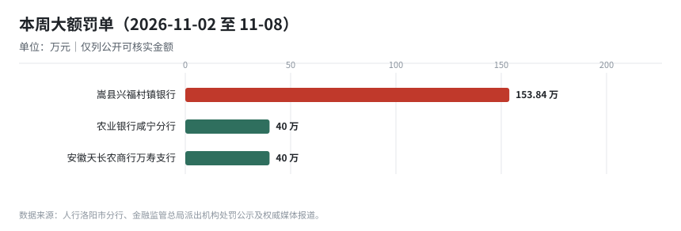
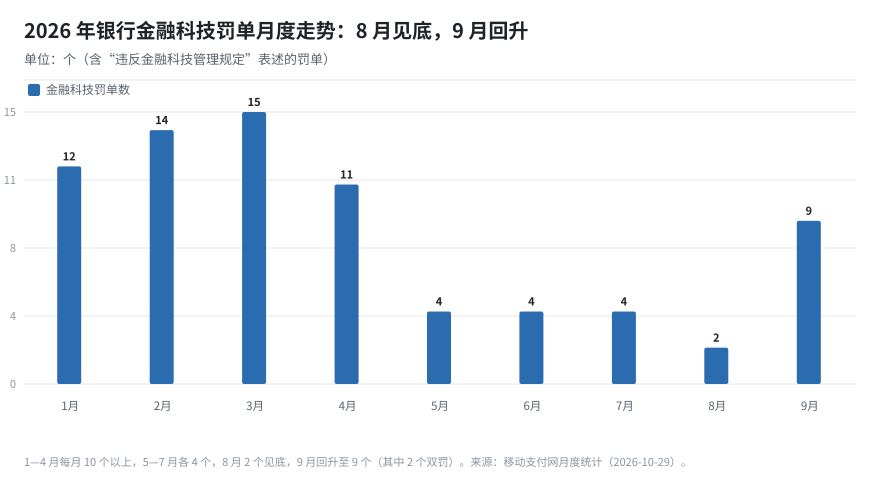
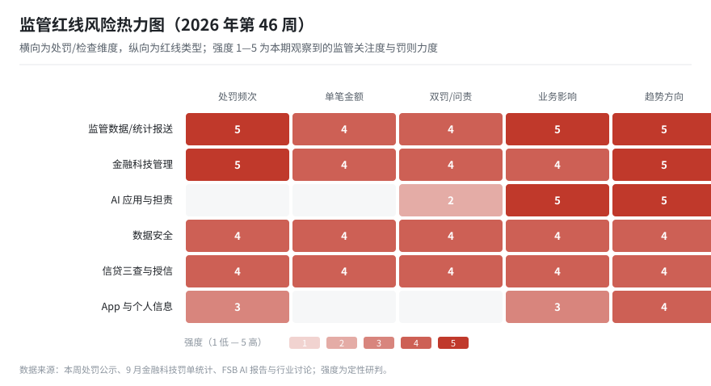

# 金融监管信息周报（2026 年第 46 周）

> **报告期间**：2026-11-02（周一）— 2026-11-08（周日）｜**生成**：2026-11-09 09:00（Asia/Shanghai）
> **读者**：监管报送业务、系统需求/开发、行领导、金融市场发展、合规管理
> **本期焦点**：保险公司董监高任职资格新规征求意见 / 金融科技罚单 9 月回升至 9 个 / **1104 月报仅剩 6 天**｜年度趋势见 [2026-ytd-penalty-trend](/regwatch/weekly/2026-ytd-penalty-trend)

---

## 0. 一页纸（给领导的 90 秒版）

**结论**：本期有两条相互印证的信号——**“人的准入”在收紧**（保险公司董监高任职资格办法征求意见，覆盖合规、风控、IT 负责人），**“技术的担责”在显性化**（9 月金融科技罚单回升至 9 个、其中 2 个双罚，被罚人来自信贷/授信而非科技部门）。同时，1104 月报只剩 6 天，是本月的第一硬约束。

**本周必须知道的 3 个动作**

1. **报送条线**：11-15 前完成 10 月 1104 与 EAST 月报（仅剩 6 天），重点核对 G01_Ⅵ 托管表与“五篇大文章”口径。
2. **合规条线**：把“金融科技管理/数据安全”责任从科技部门扩展到**信贷、授信、运营**岗位——9 月双罚案例的问责对象均非科技条线。
3. **科技条线**：若已上线智能体/AI 助手，启动“**AI 担责**”自查：谁批准、谁复核、出问题谁负责、能否一键叫停。

**3 个风险**

- 报送截止临近，**迟报/错报**与“金融统计违规”叠加，单张罚单可打穿多个环节。
- 金融科技罚单**止跌回升**，且双罚指向业务部门，责任边界模糊会放大个人风险。
- AI 智能体“自主干活”但**无审批与留痕**，一旦出错难以界定责任，监管与内部审计都会追问。

**3 个月关键时点**：2026-11-15 月报 → 2026-12-31 年度账务结转 → 2027-01-01 信托资管新规施行 → 2027-03-31 1104 年报。

---

## 0.5 合规日历（未来 120 天）

| 日期 | 剩余天数 | 类型 | 业务线 | 事项 | 牵头部门 | 状态 |
|---|---|---|---|---|---|---|
| 2026-11-15 | 6 | 月度 | 1104 | 2026 年 10 月 1104 非现场监管报表（含新增 G01_Ⅵ 托管业务表） | 报送 | 待确认 |
| 2026-11-15 | 6 | 月度 | EAST | EAST 明细数据月报（非银机构按月，银行按现行频度） | 报送 | 待确认 |
| 2026-11-20 | 11 | 月度 | 一表通 | 一表通 2.1 试点数据报送（试点机构） | 报送 | 试点跟踪 |
| 2026-12-15 | 36 | 月度 | 人行统计 | 金融统计数据报送（社融、M0/M1/M2、存贷款） | 财务 | 待确认 |
| 2026-12-31 | 52 | 年度 | 记账 | 2026 年度账务结转与 2027 年科目初始化 | 财务 | 计划 |

> **11-15 两项仅剩 6 天**，本周内应完成数据准备、首轮校验与差异说明；时点“待确认”的以监管正式通知为准。

---

## 1. 按角色阅读路径

| 角色 | 先读 | 再读 | 可跳过 | 建议时长 |
|---|---|---|---|---|
| 行领导 | §0、§2 | §6、§7 | §3—§5 | 5 分钟 |
| 监管报送业务 | §0.5、§3 | §5、§8 | §7 | 10 分钟 |
| 系统需求/开发 | §5、§4 | §6 | §2、§7 | 10 分钟 |
| 合规管理 | §6、§3.2 | §0.5、§5 | §7 | 10 分钟 |
| 金融市场发展 | §7、§2 | §6 | §3—§5 | 8 分钟 |

---

## 2. 监管方向：鼓励什么、限制什么

### 2.1 鼓励方向

| 方向 | 本期依据 | 对业务/系统的含义 |
|---|---|---|
| 智能体与 AI 应用 | 工行、交行、上海农商行等推进智能体平台；香港金管局推出“ART”框架 | AI 可以“干活”，但必须有授权、复核与叫停机制 |
| 数字人民币生态 | 累计交易 43 亿笔、31 万亿元；9 月单月 1.87 万亿元（同比 +123%） | 数币相关账户、交易、跨境场景需纳入报送与统计 |
| 信托资管规范发展 | 《资产管理信托管理办法》明确 2027-01-01 施行，要求信息科技风险管理 | 信托/代销机构需补齐系统与数据治理能力 |
| 保险机构治理 | 董监高任职资格办法征求意见，强化合规/风控/IT 负责人准入 | 高管任职材料与履职评价将更严格 |

### 2.2 限制与红线

| 红线 | 本期依据 | 性质 |
|---|---|---|
| 金融科技管理失职（含双罚） | 9 月金融科技罚单 9 个、2 个双罚，被罚人来自信贷/授信部门 | 行政处罚 + 个人问责 |
| 金融统计、征信数据报送违规 | 嵩县兴福村镇银行 153.84 万元（含金融统计、征信报送、可疑交易报告） | 行政处罚，多项并罚 |
| AI 自主执行无授权/无留痕 | FSB 12 项稳健实践、香港 ART 框架、工行“AI 担责”讨论 | 监管导向 → 预计转为检查项 |
| App 违规收集个人信息 | 国家网络安全通报中心通报 84 款应用，含 2 款银行应用 | 限期整改 |
| 贷款“三查”不尽职 | 农行咸宁分行 40 万、天长农商行万寿支行 40 万 | 行政处罚 |

**方向判断**：监管正在把“**谁来做**（人的准入）”和“**机器来做**（AI 担责）”同时纳入治理框架。对机构而言，合规不再区分“科技问题”和“业务问题”，而是看**责任是否落到具体岗位、是否有可复核的留痕**。

---

## 3. 监管报送：变更矩阵与处罚点（报送业务主读）

### 3.1 变更矩阵（制度 → 报表/字段 → 系统 → 时点）

| 制度/口径 | 涉及报表/字段 | 系统影响 | 关键时点 | 优先级 |
|---|---|---|---|---|
| 1104 2026 制度（金发〔2025〕40 号） | G01_Ⅵ 托管业务表；五篇大文章口径 | 报表平台表样、取数、校验 | **11-15 月报** / 2027-03-31 年报 | P0 |
| 一表通 2.1 | 新增 154 字段；62 表/1,498 字段映射 EAST5.0 | 监管集市 + 转换 + 对比工具 | 试点验收（Q4 起） | P0 |
| EAST 5.0 校验 | 主键完整度、字段匹配度、规则通过率 | 质量规则库、比对报表 | 随月报 | P0 |
| 征信数据报送 | 征信数据报送管理规定 | 征信取数、报送校验 | 按月 | P1 |
| 《资产管理信托管理办法》 | 信息科技风险管理、系统与数据要求 | 信托系统、代销系统 | 2027-01-01 施行 | P1 |

> 说明：嵩县兴福村镇银行罚单同时涉及“金融统计”“征信数据报送”“可疑交易报告”，说明**多口径交叉核验**已是常态，单点整改难以覆盖。

### 3.2 本期处罚点（罚点—监管取证方式—应建控制点）

| 罚点 | 处罚案例 | 监管取证方式（推断） | 应建的内部控制点 |
|---|---|---|---|
| 金融统计 + 征信报送 + 反洗钱并罚 | 嵩县兴福村镇银行 153.84 万元 | 统计报表、征信报送记录、可疑交易报告抽查 | 统一报送口径字典；跨口径对账；报送前完整性校验 |
| 金融科技管理失职（双罚） | 9 月江西寻乌农商行 246.75 万、交行新余分行 89.46 万 | 科技治理、外包、系统变更检查 | 科技治理责任矩阵；业务部门数据责任 |
| 贷款“三查”不尽职 | 农行咸宁分行 40 万、天长农商行万寿支行 40 万 | 贷前调查、审批、贷后检查记录 | “三查”模板化 + 质检抽查 |
| App 个人信息违规 | 桂银权益小程序、贵阳银行 App 被通报 | 隐私政策、第三方共享告知、单独同意 | 隐私政策逐项列明；SDK 清单管理 |

**关键洞察**：本期最值得报送条线注意的是嵩县案例——**一张罚单同时覆盖金融统计、征信报送、可疑交易报告**。这意味着监管在按“数据链路”而非“报表名称”取证，报送系统需要能回答“同一个客户/账户在多个口径下是否一致”。

---

## 4. 报送与金融科技处罚趋势（9 月回升）

| 期间 | 金融科技罚单（个） | 观察 |
|---|---|---|
| 1—4 月 | 12 / 14 / 15 / 11 | 每月 10 个以上，中小银行为主 |
| 5—7 月 | 4 / 4 / 4 | 数量回落，但单笔金额上升 |
| 8 月 | 2 | 年内月度最低 |
| 9 月 | 9 | 回升，其中 2 个双罚 |
| 10 月 | 待统计 | 本月周报持续跟踪 |

**判断**：金融科技罚单在 8 月见底后 9 月明显回升，且双罚的问责对象从科技部门转向**信贷/授信部门**。这与 10 月“双罚率 63.2%、禁业最长 12 年”的趋势一致：监管在减少罚单数量的同时，**提高每张罚单的问责深度**。报送条线不能以“罚单变少”判断风险下降。

---

## 5. 系统与需求影响（需求/开发主读）

### 5.1 影响面清单

| 影响对象 | 变更内容 | 需求类型 | 建议排期 |
|---|---|---|---|
| 报表平台 | 11-15 月报：G01_Ⅵ、五篇大文章口径 | 配置 + 校验 | 本周完成 |
| 征信报送 | 征信数据报送校验、与金融统计的一致性 | 取数 + 校验 | 11 月内 |
| AI 智能体平台 | 授权、复核、留痕、一键叫停 | 治理平台/流程 | Q4 需求池 |
| 监管集市 | 一表通 2.1 数据区、EAST5.0 转换 | 数据模型 + ETL | Q4 |
| 信托代销（如涉及） | 系统与数据能力评估 | 评估 | 2027-01-01 前 |

### 5.2 需求文档必须写清的 5 件事（不变）

1. 数据来源与口径（源系统、科目、时点、变更审批）；
2. 校验规则与容错（主键、跨表、码值；阻断/告警；责任人）；
3. 留痕与可追溯（加工链路、版本、修改记录）；
4. 双轨与回退（并存期切换、比对、回退）；
5. 责任边界（外包范围、机构主体责任）。

### 5.3 报送变更台账（累计台账）

| 变更编号 | 来源制度 | 变更类型 | 影响报表 | 优先级 | 牵头 | 状态 | 目标日期 |
|---|---|---|---|---|---|---|---|
| RC-2026-043-01 | 一表通 2.1 | 口径调整 | 一表通全表；EAST5.0 转换结果 | P0 | 报送 | 评估中 | 2026-12-31 |
| RC-2026-043-02 | 1104 2026 制度 | 新增报表 | G01_Ⅵ 托管业务情况表 | P0 | 报送 | 评估中 | 2026-12-31 |
| RC-2026-043-03 | 1104 2026 制度 | 口径调整 | G01_Ⅶ、S68、S70、S73、S74、S75 | P0 | 报送 | 评估中 | 2026-12-31 |
| RC-2026-043-04 | EAST 2.0（非银） | 频度调整 | EAST 非银报表 | P1 | 报送 | 已实施 | 2026-04-25 |
| RC-2026-043-05 | 人行金融统计 | 口径调整 | 金融统计报表 | P1 | 财务 | 已实施 | 2025-01-01 |

> 在办 3 项（均 P0），已上线/已实施 2 项。本期无新增报送制度变更；信托新规与保险董监高办法对银行端影响待评估。

---

## 6. 合规：红线清单与检查对照（合规主读）

### 6.1 红线清单（一票否决项）

| # | 红线 | 判定要点 | 本期先例 | 自查频率 |
|---|---|---|---|---|
| 1 | 报送数据不真实/多口径不一致 | 金融统计、征信、反洗钱数据是否同源 | 嵩县兴福村镇银行 153.84 万 | 月 |
| 2 | 金融科技管理失职 | 治理架构、外包、变更管理 | 9 月 9 个罚单、2 个双罚 | 季 |
| 3 | AI 应用无授权/无留痕 | 谁批准、谁复核、能否叫停 | FSB/ART 框架（导向） | 季 |
| 4 | 数据安全失守 | 分级、权限、脱敏、日志 | 招行涪陵分行 33.5 万 | 季 |
| 5 | 贷款“三查”不尽职 | 贷前/贷中/贷后 | 农行咸宁、天长农商行 | 月 |
| 6 | App 个人信息违规 | 隐私政策、第三方共享、单独同意 | 2 款银行应用被通报 | 季 |

### 6.2 检查对照表（把罚单变成自查题）

| 检查项 | 自查问题 | 证据材料 | 责任部门 |
|---|---|---|---|
| 多口径一致性 | 同一客户在金融统计、征信、反洗钱中是否一致？ | 对账报告、差异台账 | 报送 + 数据 + 合规 |
| 科技治理 | 科技治理责任是否落到业务部门？ | 责任矩阵、外包评估 | 科技 + 合规 |
| AI 担责 | 智能体是否有审批、复核、叫停机制？ | 模型清单、审批记录 | 科技 + 风险 |
| 征信报送 | 征信数据是否与源系统一致？ | 报送日志、校验记录 | 征信 + 科技 |
| App 合规 | 隐私政策是否逐项列明、SDK 是否备案？ | 隐私政策、SDK 清单 | 科技 + 消保 |

### 6.3 红线热力图

> 读法：颜色越深表示关注度/罚则力度越高。本期**报送**与**金融科技管理**两行升至最高档，**AI 担责**频次低但趋势高，属提前布局项。

---

## 7. 金融市场与业务发展（市场/业务主读）

### 7.1 关键数据

| 指标 | 数值 | 说明 |
|---|---|---|
| 数字人民币累计交易 | 43 亿笔 / 31 万亿元 | 截至 2026-09 末；9 月单月 1.87 万亿元，同比 +123% |
| 数字人民币运营机构 | 30 家 | 覆盖全部系统重要性银行 |
| 42 家 A 股上市银行前三季度营收 | 46,577.14 亿元（+7.79%） | 三季报已披露完毕 |
| 42 家 A 股上市银行前三季度净利润 | 17,467.90 亿元（+3.78%） | 利润增速低于营收 |
| 10 月制造业 PMI | 49.3% | 连续处于收缩区间 |

### 7.2 对业务方向的 3 点判断

1. **数币从“支付工具”走向“基础设施”**：43 亿笔、31 万亿元的体量，叠加智能合约与跨境场景，意味着数币相关**账户、交易、跨境结算**将逐步进入统计与报送视野。
2. **银行盈利“增收不增利”**：营收 +7.79%、净利润 +3.78%，息差压力下，中收、财富管理与 AI 降本成为关键变量。
3. **AI 投入进入“算账期”**：巴克莱、美国运通因 AI 裁员，国内银行则在建智能体平台——**AI 的价值证明与风险问责将同时到来**。

### 7.3 业务红线

- 数币与跨境场景不得绕开统计口径与外汇管理；
- AI 智能体不得在无授权情况下自主调用客户数据或发起交易；
- App 与线上渠道个人信息收集须“最小必要”。

---

## 8. 事实底表（供核对）

### 8.1 制度与会议

| 日期 | 主体 | 事项 | 要点 |
|---|---|---|---|
| 11-06 | 金融监管总局 | 《保险公司董事、监事和高级管理人员任职资格管理办法（征求意见稿）》 | 完善保险公司董监高准入管理，强化合规、风控、IT 负责人任职要求 |
| 10-30 | 金融监管总局 | 《资产管理信托管理办法》 | 2027-01-01 施行；要求信息系统与信息科技风险管理；私募定位、禁止通道/资金池 |
| 10 月 | 金融稳定理事会（FSB） | 《负责任地采用人工智能的稳健实践（最终报告）》 | 12 项稳健实践，分机构治理与全生命周期两组 |
| 10 月 | 香港金管局 | “ART”框架 | 回应 AI 自主执行的责任归属、数据调取、紧急叫停 |

### 8.2 处罚（公开可核实部分）

| 日期 | 机构 | 事由 | 金额（万元） | 备注 |
|---|---|---|---|---|
| 11-06 | 嵩县兴福村镇银行 | 违反金融统计规定；账户管理；数据安全；人民币流通；**征信数据报送**；可疑交易报告；为身份不明客户提供服务 | 153.84 | 警告并罚款 |
| 11-04 前后 | 农业银行咸宁分行 | 按揭贷款“三查”严重不尽职 | 40.00 | — |
| 11-04 前后 | 安徽天长农商行万寿支行 | 贷款“三查”不尽职 | 40.00 | — |
| 10-26 | 招商银行重庆涪陵分行 | 违反金融统计规定；账户管理；数据安全 | 33.50 | 警告并罚款 |
| 9 月 | 江西寻乌农商行 | 违反金融科技业务管理规定等 7 项 | 246.75 | 信贷部人员双罚 1.5 万 |
| 9 月 | 交通银行新余分行 | 违反金融科技管理规定等 6 项 | 89.46 | 风险与授信管理部人员双罚 4.5 万 |
| 9-30 | 浦发银行淮南分行 | 未按规定开展金融科技业务、未制定内部安全管理操作规程等 4 项 | 73.00 | 指向数据安全 |

### 8.3 行业统计

| 指标 | 数值 | 口径 |
|---|---|---|
| 9 月金融科技罚单 | 9 个（2 个双罚） | 含“违反金融科技管理规定”表述 |
| 2026 年金融科技双罚 | 累计 5 个（截至 9 月） | 移动支付网统计 |
| 数字人民币累计交易 | 43 亿笔 / 31 万亿元 | 截至 2026-09 末 |
| 通报 App | 84 款，含 2 款银行应用 | 国家网络安全通报中心 10-26 |

---

## 9. 行动清单（按优先级与责任）

| 优先级 | 事项 | 牵头 | 配合 | 时限 |
|---|---|---|---|---|
| P0 | 11-15 月报数据准备、首轮校验与差异说明 | 报送 | 财务/科技 | 11-13 |
| P0 | 金融统计/征信/反洗钱多口径一致性核对 | 报送 | 数据/合规 | 11-15 |
| P0 | 贷款“三查”抽查（按揭、经营贷） | 信贷 | 风险 | 11-20 |
| P1 | AI 智能体授权与留痕自查 | 科技 | 风险/合规 | 11-30 |
| P1 | App 隐私政策与 SDK 清单复核 | 科技 | 消保 | 11-30 |
| P2 | 一表通 2.1 映射差异分析推进 | 报送 | 数据/科技 | Q4 |

---

## 10. 信息来源

- 上海证券报《金融监管总局就保险公司董监高任职资格管理办法公开征求意见》（2026-11-06）：<https://www.cnstock.com/commonDetail/825094>
- 新浪财经/金融一线《嵩县兴福村镇银行被罚153.84万元》（2026-11-06）：<https://www.sohu.com/a/1098158182_122014422>
- 移动支付网《9月新增9个银行金融科技罚单》（2026-10-29）：<https://www.mpaypass.com.cn/news/202610/29165709.html>
- 移动支付网《【一周观察】AI担责被热议，2家银行App被通报》（2026-11-02）：<https://www.mpaypass.com.cn/news/202611/02091728.html>
- 移动支付网《招行因违反数据安全管理规定等被罚》（2026-10-26）：<https://www.mpaypass.com.cn/news/202610/26180603.html>
- 搜狐《农业银行咸宁分行被罚40万元》（2026-11）：<https://m.sohu.com/coo/zmtq/1098138020_122014422>
- 东方财富《安徽天长农商行万寿支行被罚40万》（2026-11）：<https://guba.eastmoney.com/news,cjpl,1793320118.html>

---

*本报告由自动化任务生成。事实以公开来源为准，处罚金额与事由以监管公示原文为最终依据；强度评级与方向判断为分析观点，不构成合规结论。*
