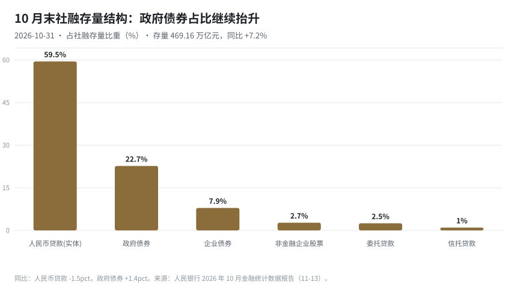
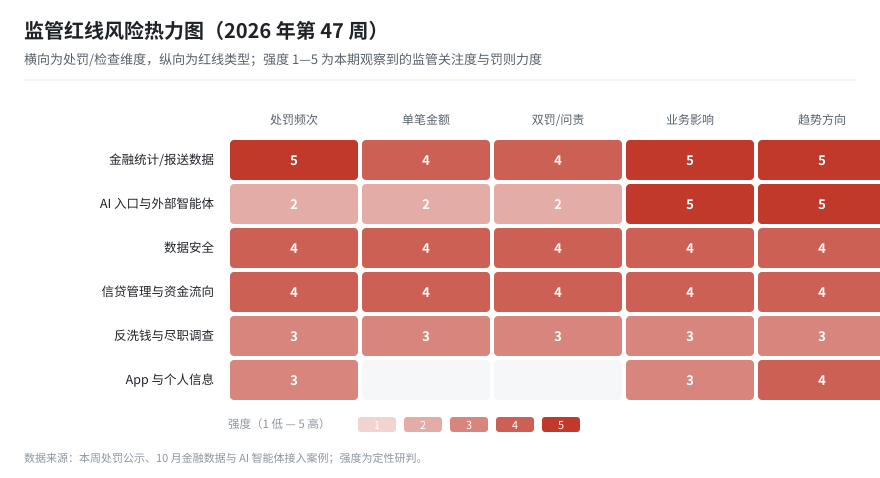
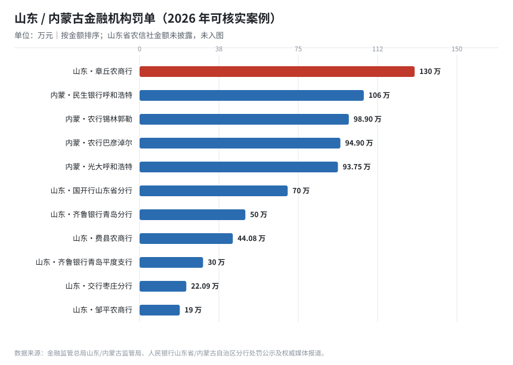

# 金融监管信息周报（2026 年第 47 周）

> **报告期间**：2026-11-09（周一）— 2026-11-15（周日）｜**生成**：2026-11-17 09:59（Asia/Shanghai）
> **说明**：本期原定 11-16（周一）09:00 生成，因定时任务未触发，于 11-17 补发；覆盖期不变。
> **本期焦点**：10 月金融数据“社融靠政府债、信贷偏弱” / 招行信用卡接入外部 AI 智能体 / 金融统计罚单持续（交行枣庄）/ **1104 月报已到期，状态待确认**
> **年度趋势**：[2026-ytd-penalty-trend](/regwatch/weekly/2026-ytd-penalty-trend)

---

## 0. 一页纸（给领导的 90 秒版）

**结论**：本周三条线同时推进——**金融数据确认“信贷弱、直接融资强”**（10 月社融增量靠政府债与企业债，住户贷款净减少 1.46 万亿元）；**AI 入口从“权益营销”转向“生态接入”**（招行信用卡首批接入微信、千问智能体，但只开放只读查询）；**金融统计类罚单继续落地**（交行枣庄分行 22.09 万元，山东辖区交行年内第 6 罚）。同时，**11-15 的 1104 与 EAST 月报已到期，日历状态仍为“待确认”**。

**本周必须知道的 3 个动作**

1. **报送条线**：立即确认 11-15 的 1104 与 EAST 月报是否已报出，更新合规日历状态；未报的评估补报与沟通方案。11-20 一表通 2.1 试点报送仅剩 3 天。
2. **科技条线**：对 AI 入口做一次合规评估——**接口级对接（只读、可审计）** vs **屏幕自动化（代客操作）**，明确数据不出域、身份核验与责任边界。
3. **业务条线**：信贷投放向政府相关项目、直接融资（债券承销/投资）倾斜；零售贷款收缩背景下，重新评估零售考核与产品结构。

**3 个风险**

- 月报逾期未关闭，叠加“金融统计违规”独立罚点，**迟报/漏报**风险上升。
- AI 智能体接入若边界不清（代客操作、敏感数据外传），**责任认定**将非常困难。
- 贷款投放若为冲量而“空转”或错标投向，会在**统计口径与现场检查**中暴露。

**3 个月关键时点**：2026-11-20 一表通试点报送 → 2026-12-15 人行统计月报 → 2026-12-31 年度账务结转 → 2027-03-31 1104 年报。

---

## 0.5 合规日历（截至 2026-11-17）

**未来 120 天**

| 日期 | 剩余天数 | 类型 | 业务线 | 事项 | 牵头部门 | 状态 |
|---|---|---|---|---|---|---|
| 2026-11-20 | 3 | 月度 | 一表通 | 一表通 2.1 试点数据报送（试点机构） | 报送 | 试点跟踪 |
| 2026-12-15 | 28 | 月度 | 人行统计 | 金融统计数据报送（社融、M0/M1/M2、存贷款） | 财务 | 待确认 |
| 2026-12-31 | 44 | 年度 | 记账 | 2026 年度账务结转与 2027 年科目初始化 | 财务 | 计划 |

**已逾期未关闭**

| 日期 | 逾期天数 | 业务线 | 事项 | 状态 |
|---|---|---|---|---|
| 2026-11-15 | 2 | 1104 | 2026 年 10 月 1104 非现场监管报表（含新增 G01_Ⅵ 托管业务表） | 待确认 |
| 2026-11-15 | 2 | EAST | EAST 明细数据月报（非银机构按月，银行按现行频度） | 待确认 |

> **请本周内确认并更新状态**：若已完成，用 `regdata.py set` 改为“已完成”；若未完成，需评估补报、差异说明与监管沟通方案。

---

## 1. 按角色阅读路径

| 角色 | 先读 | 再读 | 可跳过 | 建议时长 |
|---|---|---|---|---|
| 行领导 | §0、§2 | §4、§7 | §3、§5 | 5 分钟 |
| 监管报送业务 | §0.5、§3 | §5、§8 | §7.4 以外 | 10 分钟 |
| 系统需求/开发 | §5、§3 | §6 | §2、§7 | 10 分钟 |
| 合规管理 | §6、§3.2 | §0.5、§5 | §7 | 10 分钟 |
| 金融市场发展 | §7、§2 | §6 | §3—§5 | 8 分钟 |

---

## 2. 监管方向：鼓励什么、限制什么

### 2.1 鼓励方向

| 方向 | 本期依据 | 对业务/系统的含义 |
|---|---|---|
| 金融结构优化、直接融资 | 10 月数据：企业债净融资 3.1 万亿（同比多 1.27 万亿）；Q3 货币政策报告讨论“钱去哪了”与直接融资占比 | 债券承销/投资、投行业务空间扩大；贷款投向统计需同步 |
| 财富管理与跨界合作 | 总局王胜邦 11-13：支持金融机构依法有序开展跨界合作，提供财务规划、投顾、资管服务 | 财富管理产品与代销系统需求增加，销售适当性要求同步 |
| 科技金融与耐心资本 | 王胜邦：支持银行对接不同阶段科创企业，打好“股权+信贷”接力 | 科技型企业评价模型、投贷联动 |
| AI 服务入口 | 招行信用卡接入微信“小微”、千问智能体（只读查询） | 服务从“人找服务”转向“服务找人”，需接口治理 |
| 消费与居民金融服务 | 王胜邦：金融支持消费要与提高居民收入、完善社保结合 | 消费贷、信用卡场景化经营，但需防过度授信 |

### 2.2 限制与红线

| 红线 | 本期依据 | 性质 |
|---|---|---|
| 金融统计违规 | 交行枣庄分行 22.09 万元（金融统计+人民币流通）；费县农商行 44.08 万元 | 行政处罚，独立罚点 |
| AI 代客操作/屏幕自动化 | 豆包手机助手 SAEP 放开屏幕操作，工行、招行等拒绝授权；招行仅做接口级只读接入 | 风险边界，监管规则待细化 |
| 贷款用途与资金流向 | 交行枣庄、国开行山东等罚单均指向贷款管理/实贷实付 | 行政处罚 |
| 信托内控（新规衔接） | 中信信托 175 万元罚单（年内二度） | 行政处罚 |
| 数据安全与个人信息 | 前期 App 通报延续 | 行政处罚/通报 |

**方向判断**：监管在“**做大直接融资、做优财富管理**”的同时，对“**数据真实性**”和“**AI 边界**”同步收紧。对机构而言，AI 入口不是不能做，而是必须**由银行定义开放边界**——只读、可审计、数据不出域，才具备可持续性。

---

## 3. 监管报送：变更矩阵与处罚点（报送业务主读）

### 3.1 变更矩阵（制度 → 报表/字段 → 系统 → 时点）

| 制度/口径 | 涉及报表/字段 | 系统影响 | 关键时点 | 优先级 |
|---|---|---|---|---|
| 1104 2026 制度 | G01_Ⅵ 托管表；五篇大文章口径 | 报表平台表样、取数、校验 | 11-15 已到期（待确认）/ 2027-03-31 年报 | P0 |
| 一表通 2.1 | 新增 154 字段；62 表/1,498 字段映射 | 监管集市 + 转换 + 对比 | 11-20 试点报送 | P0 |
| EAST 5.0 校验 | 主键、字段匹配、规则通过率 | 质量规则库 | 随月报 | P0 |
| AI 入口数据 | 智能体调用日志、用户授权、数据流向 | 接口网关、审计日志 | 接入前评估 | P1 |
| 人行金融统计 | M1 新口径、社融分项 | 统计指标字典 | 12-15 | P1 |

### 3.2 本期处罚点（罚点—监管取证方式—应建控制点）

| 罚点 | 处罚案例 | 监管取证方式（推断） | 应建的内部控制点 |
|---|---|---|---|
| 金融统计违规 | 交行枣庄分行 22.09 万元（+人民币流通） | 统计报表与源系统、现金管理记录比对 | 统计口径字典；现金/流通类指标专项校验 |
| 金融统计+账户+网络安全+可疑交易 | 费县农商行 44.08 万元 | 多口径交叉核验、可疑交易报告抽查 | 跨口径对账；网络安全与报送联动 |
| 信托内控 | 中信信托 175 万元 | 产品“拼单”、适当性、信息披露检查 | 销售适当性、拼单识别、信息披露留痕 |
| 贷款管理/实贷实付 | 交行枣庄、国开行山东（前期） | 贷前调查、受托支付、贷后检查 | 受托支付刚性控制、资金流向监测 |

**关键洞察**：本期两笔山东罚单都含“**金融统计**”，且费县案同时叠加账户、网络安全、可疑交易——监管仍在按“**数据链路**”取证。报送条线要把“统计报表”与“账户、现金、可疑交易”放在同一张对账表里看。

---

## 4. 数据与处罚趋势

### 4.1 10 月金融数据（11-13 发布）

| 指标 | 2026-10 末 | 同比/结构 |
|---|---|---|
| 社融存量 | 469.16 万亿元 | +7.2% |
| 对实体经济人民币贷款 | 279.31 万亿元 | +4.6%（占比 59.5%，-1.5pct） |
| 政府债券 | 106.41 万亿元 | +14.4%（占比 22.7%，+1.4pct） |
| 企业债券 | 36.92 万亿元 | +9.6%（占比 7.9%，+0.2pct） |
| M2 / M1 / M0 | +7.1% / +4.4% / +10.7% | M1 回升，剪刀差收窄 |
| 前十个月社融增量 | 28.61 万亿元 | 同比少 2.29 万亿元 |
| 前十个月人民币贷款 | +11.42 万亿元 | 住户 -1.46 万亿元；企业 +12.39 万亿元 |

**判断**：社融“政府债托底、信贷偏弱”的格局进一步固化；企业债净融资同比多 1.27 万亿元，**直接融资对信贷的替代在加速**。对报送条线而言，贷款投向、债券投资、政府相关项目的统计口径权重继续上升。

### 4.2 处罚基线（W46：11-09—11-15）

| 周次 | 期间 | 全量处罚单数 | 涉及机构 | 已知最大单笔（万元） | 备注 |
|---|---|---|---|---|---|
| W46 | 11-09—11-15 | 1 单 | 1 家 | 22.09（交行枣庄） | 统计+人民币流通；费县 44.08 万为 10-13 公示，计入区域 YTD |

> 2026 年罚单“量降额稳、问责加重”的年度趋势未变，详见年度专题。

---

## 5. 系统与需求影响（需求/开发主读）

### 5.1 影响面清单

| 影响对象 | 变更内容 | 需求类型 | 建议排期 |
|---|---|---|---|
| 报表平台 | 11-15 月报补报/确认；G01_Ⅵ、五篇大文章 | 配置 + 校验 | 本周 |
| 监管集市 | 一表通 2.1 数据区、EAST5.0 转换 | 数据模型 + ETL | 11-20 前 |
| AI 接口网关 | 智能体接入授权、只读服务、调用日志、数据脱敏 | 网关 + 审计 | 接入前 |
| 统计指标 | M1 新口径、社融分项 | 指标字典 | 按月 |
| 现金/流通类指标 | 人民币流通、假币收缴等 | 校验规则 | Q4 |

### 5.2 需求文档必须写清的 5 件事（不变）

1. 数据来源与口径（源系统、科目、时点、变更审批）；
2. 校验规则与容错（主键、跨表、码值；阻断/告警；责任人）；
3. 留痕与可追溯（加工链路、版本、修改记录）；
4. 双轨与回退（并存期切换、比对、回退）；
5. 责任边界（外包范围、机构主体责任）。

### 5.3 报送变更台账（累计台账）

| 变更编号 | 来源制度 | 变更类型 | 影响报表 | 优先级 | 牵头 | 状态 | 目标日期 |
|---|---|---|---|---|---|---|---|
| RC-2026-043-01 | 一表通 2.1 | 口径调整 | 一表通全表；EAST5.0 转换结果 | P0 | 报送 | 评估中 | 2026-12-31 |
| RC-2026-043-02 | 1104 2026 制度 | 新增报表 | G01_Ⅵ 托管业务情况表 | P0 | 报送 | 评估中 | 2026-12-31 |
| RC-2026-043-03 | 1104 2026 制度 | 口径调整 | G01_Ⅶ、S68、S70、S73、S74、S75 | P0 | 报送 | 评估中 | 2026-12-31 |
| RC-2026-043-04 | EAST 2.0（非银） | 频度调整 | EAST 非银报表 | P1 | 报送 | 已实施 | 2026-04-25 |
| RC-2026-043-05 | 人行金融统计 | 口径调整 | 金融统计报表 | P1 | 财务 | 已实施 | 2025-01-01 |

> 在办 3 项（均 P0）。本期新增 AI 入口相关数据治理事项，待评估后入账。

---

## 6. 合规：红线清单与检查对照（合规主读）

### 6.1 红线清单（一票否决项）

| # | 红线 | 判定要点 | 本期先例 | 自查频率 |
|---|---|---|---|---|
| 1 | 报送逾期/漏报 | 月报是否按时报出、差异是否说明 | 11-15 月报待确认 | 月 |
| 2 | 金融统计不真实 | 统计报表与源系统、现金记录是否一致 | 交行枣庄、费县农商行 | 月 |
| 3 | AI 代客操作/数据外传 | 是否屏幕自动化、是否只读、日志是否完整 | 豆包 SAEP 授权争议 | 季 |
| 4 | 贷款用途与实贷实付 | 受托支付、资金流向 | 交行枣庄、国开行山东 | 月 |
| 5 | 信托销售适当性 | 拼单、风险匹配、信息披露 | 中信信托 175 万 | 季 |
| 6 | 数据安全 | 分级、权限、脱敏、日志 | 前期通报延续 | 季 |

### 6.2 检查对照表（把罚单变成自查题）

| 检查项 | 自查问题 | 证据材料 | 责任部门 |
|---|---|---|---|
| 月报时效 | 11-15 月报是否已报？未报原因？ | 报送回执、差异说明 | 报送 |
| 统计一致性 | 统计报表与源系统、现金记录是否一致？ | 对账报告 | 财务 + 报送 |
| AI 入口 | 是否只读、是否数据不出域、日志是否可审计？ | 接口清单、授权记录、日志 | 科技 + 风险 |
| 贷款受托支付 | 是否严格执行实贷实付？ | 支付凭证、贷后检查 | 信贷 |
| 信托代销 | 是否存在拼单、是否完成适当性评估？ | 销售记录、评估表 | 零售 + 合规 |

### 6.3 红线热力图

> 读法：颜色越深表示关注度/罚则力度越高。本期**金融统计/报送**与**AI 入口**两行最值得关注：前者是“已发生的处罚”，后者是“即将到来的规则”。

---

## 7. 金融市场与业务发展（市场/业务主读）

### 7.1 关键数据

| 指标 | 数值 | 说明 |
|---|---|---|
| 10 月社融存量 | 469.16 万亿元（+7.2%） | 政府债占比 22.7% |
| 前十个月社融增量 | 28.61 万亿元（少 2.29 万亿） | 信贷少增、企业债多增 |
| 前十个月人民币贷款 | 11.42 万亿元 | 住户 -1.46 万亿，企业 +12.39 万亿 |
| M1 | +4.4% | 较 9 月（+3.2%）回升 |
| 10 月同业拆借/回购利率 | 1.3% / 1.33% | 环比下行 |

### 7.2 对业务方向的 3 点判断

1. **“信贷弱、直融强”是结构性而非周期性**：企业债净融资同比多 1.27 万亿元，银行应把债券承销、投行、托管作为对公增长点，同时把“贷款+债券+股权”纳入客户综合融资方案。
2. **零售信贷持续收缩**：住户贷款前十个月净减少 1.46 万亿元，短期贷款减少 1.41 万亿元，零售条线需从“规模扩张”转向“存量经营+场景分期”。
3. **AI 入口是渠道变革，不是产品创新**：招行接入微信/千问只开放查询类只读服务，说明**“服务找人”可以先做“轻服务”**；交易类、授信类仍应留在行内闭环。

### 7.3 业务红线

- 不得以“AI 入口”名义把高风险交易交给外部智能体；
- 贷款不得为冲量而空转、错标投向；
- 财富管理跨界合作须守住适当性与信息披露底线。

### 7.4 区域观察：山东与内蒙古罚单统计（固定栏目）

> 口径：两省区内城商行/农商行/农信社/国有行与股份行分行、政策性银行分行；仅列公开可核实金额；“未披露”不计入合计。

| 省份 | 机构 | 日期 | 主要事由 | 金额（万元） |
|---|---|---|---|---|
| 山东 | 章丘农商行 | 07-29 | 流贷、票据贴现、资产分类、**不良贷款处置数据不真实** | 130.00 |
| 山东 | 国开行山东省分行 | 11-07 | 流贷管理不到位、固贷未实贷实付 | 70.00 |
| 山东 | 齐鲁银行青岛分行 | 10-30 | 贷款用途审查、贷后管理 | 50.00 |
| 山东 | 费县农商行 | 10-13 | **金融统计**、账户、网络安全、可疑交易 | 44.08 |
| 山东 | 齐鲁银行青岛平度支行 | 10-30 | 信用证贸易背景、福费廷回流 | 30.00 |
| 山东 | 交行枣庄分行 | 11-03 | **金融统计**、人民币流通 | 22.09 |
| 山东 | 邹平农商行 | 10-09 | 信用信息采集 | 19.00 |
| 山东 | 山东省农信社 | 09 月 | **错报非现场监管报表** | 未披露 |
| 内蒙古 | 民生银行呼和浩特分行 | 11-01 | **金融统计**、国库业务 | 106.00 |
| 内蒙古 | 农行锡林郭勒分行 | 10-30 | **提供虚假统计报表**、尽调 | 98.90 |
| 内蒙古 | 农行巴彦淖尔分行 | 10-30 | **金融统计**、数据安全、征信、反洗钱 | 94.90 |
| 内蒙古 | 光大银行呼和浩特分行 | 11-02 | **金融统计**、人民币流通、征信 | 93.75 |

**三点判断：**

1. **内蒙古“统计报送集中处罚”特征延续**：4 笔百万元级罚单全部含金融统计，农行锡林郭勒被明确认定“提供虚假的统计报表”。
2. **山东新增两笔“统计类”罚单**：交行枣庄（22.09 万）、费县农商行（44.08 万）均含金融统计，且费县叠加账户、网络安全、可疑交易——说明山东辖内对**基础数据与现金管理**的检查在加强；交行在山东辖区年内已有 6 个分支机构被罚。
3. **地方性校验建议**：两省共同点是“报表数字与业务实质脱节”，建议在月报前增加“**统计报表 × 账户/现金 × 可疑交易**”三方对账，并把“资产质量类指标与台账比对”纳入山东辖内机构的固定自查。

---

## 8. 事实底表（供核对）

### 8.1 制度与会议

| 日期 | 主体 | 事项 | 要点 |
|---|---|---|---|
| 11-12 | 人民银行 | 2026 年第三季度货币政策执行报告 | 总结前三季度政策执行；专章讨论“钱去哪了”与金融结构；适度宽松持续显效 |
| 11-13 | 金融监管总局 | 王胜邦在财新峰会讲话 | 金融总量与名义 GDP 匹配、防杠杆；支持财富管理跨界合作；人身险回归保障 |
| 11-13 | 人民银行 | 2026 年 10 月金融统计数据 | 社融存量 469.16 万亿（+7.2%）；M2 +7.1%、M1 +4.4% |
| 10-30 | 金融监管总局 | 《资产管理信托管理办法》 | 2027-01-01 施行；私募定位、禁止通道/资金池 |

### 8.2 处罚（公开可核实部分）

| 日期 | 机构 | 事由 | 金额（万元） |
|---|---|---|---|
| 11-10 报道 | 交通银行枣庄分行 | 违反金融统计规定；违反人民币流通管理规定 | 22.09 |
| 10-13 | 山东费县农商行 | 金融统计；账户；网络安全；未按规定报告可疑交易 | 44.08 |
| 11-11 报道 | 中信信托 | 内控短板（“拼单”等），年内二度被罚 | 175.00 |
| 11-01 | 民生银行呼和浩特分行 | 金融统计；国库业务 | 106.00 |

> 中信信托罚单细节以监管公示原文为准，本条仅作事实索引。

### 8.3 金融科技

| 事项 | 要点 |
|---|---|
| 招行信用卡接入外部智能体 | 11-11 报道：首批接入微信“小微”、千问智能体，仅开放账单查询等只读服务；身份核验、支付等高危环节仍在行内 |
| 豆包屏幕自动化争议 | 豆包手机助手 SAEP 放开屏幕操作，工行、招行等列入拒绝授权清单；与接口级对接形成“一拒一放”对比 |
| Q3 货币政策报告 | 强调直接融资占比提升、金融结构变化 |

---

## 9. 行动清单（按优先级与责任）

| 优先级 | 事项 | 牵头 | 配合 | 时限 |
|---|---|---|---|---|
| P0 | 确认 11-15 月报状态并更新日历；未报则制定补报方案 | 报送 | 财务/科技 | 11-18 |
| P0 | 一表通 2.1 试点报送准备（11-20） | 报送 | 数据/科技 | 11-19 |
| P0 | 金融统计 × 账户/现金 × 可疑交易三方对账 | 财务 | 报送/合规 | 11-30 |
| P1 | AI 入口合规评估（只读、日志、数据不出域） | 科技 | 风险/合规 | 11-30 |
| P1 | 贷款受托支付与资金流向抽查 | 信贷 | 风险 | 11-30 |
| P2 | 信托代销适当性与“拼单”自查 | 零售 | 合规 | 12-15 |

---

## 10. 信息来源

- 上海证券报《央行：10 月末 M2 余额 359.06 万亿元 同比增长 7.1%》（2026-11-13）：<https://www.sohu.com/a/1101168248_120988576>
- 央广网《央行发布 2026 年第三季度中国货币政策执行报告》（2026-11-12）：<https://finance.cnr.cn/txcj/20261112/t20261112_527870472.shtml>
- 中国经济网《金融监管总局：改善面向居民的金融服务》（2026-11-13）：<http://finance.ce.cn/bank12/scroll/202611/t20261113_3293922.shtml>
- 半岛网《交行枣庄分行被罚 22.09 万元》（2026-11-10）：<http://finance.bandao.cn/a/1794292727776648498.html>
- 新浪财经《山东费县农商行被罚 440800 元》（2026-10-13）：<https://www.sohu.com/a/1087267825_122014422>
- 中华网财经《招行信用卡接入两大外部智能体》（2026-11-12）：<https://finance.china.com/jinrong/13004689/20261112/49864506.html>
- 中华网财经《中信信托再领 175 万元罚单》（2026-11-11）：<https://finance.china.com/jinrong/13004689/20261111/49862586.html>

---

*本报告由自动化任务生成。事实以公开来源为准，处罚金额与事由以监管公示原文为最终依据；强度评级与方向判断为分析观点，不构成合规结论。*
