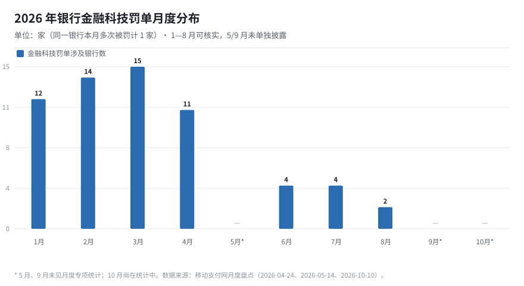
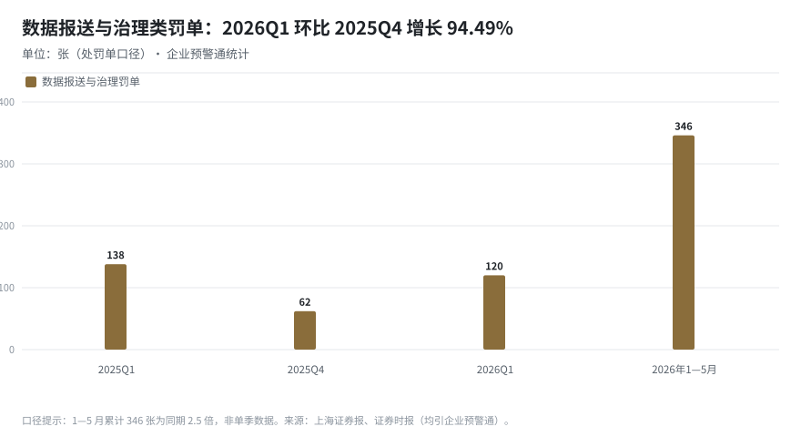

# 2026 年报送与数据类处罚趋势（1—10 月）

> **编制**：2026-10-27｜**数据截止**：2026-10-26 公开可核实信息
> **范围**：银行机构因**监管数据报送、数据安全、金融科技（信息科技）管理、金融统计**受罚的行政处罚
> **配套数据**：`data/yearly/2026-penalty-cases.csv`（35 起）、`data/yearly/2026-penalty-trend.csv`（汇总指标）

---

## 0. 一页结论

1. **量级跃迁**：报送与数据类处罚已从“年度零星”变为“季度常态”。2026 年 1—5 月数据报送与治理类罚单 **346 张**（去年同期 2.5 倍）、被罚银行 **277 家**（3 倍）、百万元级罚单 **78 家**（近 4 倍）；数据安全类罚单 1—5 月 **55 张**，已超 2025 年全年。
2. **结构突变**：上半年以“中小机构、小额、批量”为主；**9—10 月转为“大行、千万级、报送单独计价”**——邮储 1,743.3 万、广发 1,712.4 万、江苏 937.1 万、渤海 534.4 万，湖北银行 285 万把“EAST 报送不合规”写成独立罚点。
3. **问责升级**：双罚从“个别”走向“常态”，且被罚人不只在科技部门——灵寿、赞皇 4 名责任人中仅 1 人来自科技部门。
4. **一句话给报送条线**：监管已把“数据”当作**业务真实性的证据**来用，报送质量不再是后台指标，而是**可独立立案的合规红线**。

---

## 1. 口径说明（先看这个，避免误读）

| 指标 | 统计口径 | 数据来源 | 局限 |
|---|---|---|---|
| 金融科技罚单（家/月） | 罚单中含“违反金融科技管理规定”或类似表述的**银行家数** | 移动支付网月度盘点 | 5、9 月未单独披露；10 月未出盘点 |
| 数据报送与治理罚单（张） | 企业预警通“数据报送与治理”分类，**处罚单口径** | 上海证券报、证券时报（引企业预警通） | 与“金融科技罚单”存在交叉，不可直接相加 |
| 数据安全罚单（张） | 含“数据安全”违规项的罚单 | 证券时报引企业预警通 | 多为综合罚单中的子项 |
| 个案罚单（万元） | 周报整理的 35 起典型个案 | 监管公示与权威媒体报道 | 仅为样本，非全量 |
| 季度对比 | 2025Q1 / 2025Q4 / 2026Q1 | 企业预警通 | 仅 Q1 可比，Q2—Q3 无同口径披露 |

> **重要**：市面上“罚单数”有三种口径（家数 / 张数 / 处罚单数），本报告逐项标注，**不做跨口径加总**。

---

## 2. 月度节奏：金融科技罚单“前高后低”，报送罚单“后程发力”

| 月份 | 金融科技罚单涉及银行（家） | 观察 |
|---|---|---|
| 1 月 | 12 | 全部为中小银行；出现 1 起科技条线双罚 |
| 2 月 | 14 | 首次出现国有行、股份行分行；四川银行、资中农商行百万级 |
| 3 月 | 15 | 年内峰值；仁化农商行“未有效监测漏洞类数据安全风险”35 万 |
| 4 月 | 11 | 11 家、1 起双罚；中原银行 884.37 万、中行海南 764.84 万 |
| 5 月 | 未单独披露 | 泉州银行 625 万（第三方合作数据安全管控不到位） |
| 6 月 | 4 | 工行 105 万、建行 70 万、交行 80 万（重要信息系统管控）；新韩银行 249 万 |
| 7 月 | 4 | 中行某分行 436 万；苏州银行网络安全/数据安全 |
| 8 月 | 2 | 年内月度最少；中关村银行 268.88 万（首家民营银行） |
| 9 月 | 未单独披露 | 9-24 央行批次：邮储/广发/江苏/渤海合计罚没 4,937.51 万 |
| 10 月 | 统计中 | 湖北银行 285 万（EAST）；灵寿、赞皇数据安全双罚 |

**读法**：金融科技专项罚单数量在 6 月后明显回落，但**单笔金额与机构层级同步上升**——不是监管放松，而是执法从“广撒网”转向“打大案”。

| 期间 | 罚单（张） | 备注 |
|---|---|---|
| 2025Q1 | 138 | 同期基数 |
| 2025Q4 | 62 | 环比基数 |
| 2026Q1 | 120 | **环比 +94.49%**，为环比增幅最大类别 |
| 2026 年 1—5 月 | 346 | 去年同期 2.5 倍；被罚银行 277 家 |

---

## 3. 结构变化：三个“从…到…”

| 维度 | 上半年（1—5 月） | 下半年（9—10 月） | 含义 |
|---|---|---|---|
| 处罚对象 | 农商行、村镇银行、农信社为主 | 国有行、股份行、头部城商行 | 监管从“查小机构”转向“查系统性机构” |
| 单笔金额 | 数万—数十万为主，个别百万级 | 千万级（邮储 1,743 万、广发 1,712 万） | 罚则力度与机构规模匹配，**大行不再“豁免”** |
| 报送定性 | 与信贷、反洗钱“打包” | EAST 报送不合规**单独立项**（湖北银行） | 报送从“附带项”变“独立罚点” |
| 问责方式 | 以罚机构为主 | 双罚常态化，且波及业务/运营岗 | **责任不只在科技部门** |

---

## 4. 典型个案（按金额，节选）

| 日期 | 机构 | 主要事由 | 金额（万元） | 责任人 |
|---|---|---|---|---|
| 09-24 | 邮储银行 | 金融统计、数据安全、反洗钱等 10 项 | 1,743.30 | 8 人共 22 万 |
| 09-24 | 广发银行 | 金融统计、数据安全、反洗钱等 10 项 | 1,712.40 | 12 人共 55.5 万 |
| 09-24 | 江苏银行 | 13 项，含数据安全、网络安全 | 937.10 | 6 人 |
| 04 | 中原银行 | 数据报送与治理、网络安全等 | 884.37 | — |
| 04 | 中国银行海南省分行 | 数据报送与治理 | 764.84 | — |
| 05 | 泉州银行 | 第三方合作数据安全风险管控不到位 | 625.00 | — |
| 09-24 | 渤海银行 | 11 项，含数据安全、网络安全 | 534.37 | 6 人 1—5 万 |
| 07 | 中国银行某分行 | 违反数据安全管理规定等 | 436.00 | — |
| 03 | 南宁市区农信联社 | 数据报送与治理、数据安全、金融统计 | 293.86 | — |
| 10 | 湖北银行 | **EAST 数据报送不合规** + 业务管理不尽职 | 285.00 | — |
| 01 | 绍兴恒信农商行 | 数据安全/网络安全、反洗钱等 9 项 | 271.40 | 3 人（科技部 1 万） |
| 08-11 | 北京中关村银行 | 网络安全、数据安全等 9 项 | 268.88 | — |
| 06 | 新韩银行（中国） | 金融统计、数据安全等 9 项 | 249.00 | — |
| 10-12 | 河北灵寿农商行 | 数据安全、账户、反洗钱等 7 项 | 150.19 | 2 人各 2 万 |
| 10-12 | 赞皇县农信联社 | 数据安全、账户、反洗钱等 6 项 | 139.80 | 2 人各 1 万 |
| 01 | 重庆九龙坡民泰村镇银行 | 数据安全等多项 | 113.80 | — |
| 02-28 | 北京农商银行 | 违反数据安全管理相关规定 | 100.00 | 2 人共 28 万 |

> 完整 35 起见 `data/yearly/2026-penalty-cases.csv`（含来源、机构类型、是否双罚）。

---

## 5. 与制度节奏的叠加：为什么是 2026 年

| 时间 | 制度事件 | 对处罚的影响 |
|---|---|---|
| 2024 年末 | 《银行保险机构数据安全管理办法》发布 | 2026 年进入**执法兑现期** |
| 2025 年中 | 《中国人民银行业务领域数据安全管理办法》实施 | 央行分支行获得明确罚则 |
| 2025-12 | 《金融机构数据安全管理能力提升专项行动》（金办发〔2025〕93 号） | “发现一批、整改一批、通报一批、处罚一批”，**2026 年 4—10 月集中检查** |
| 2026-01 | 1104 2026 制度（金发〔2025〕40 号）下发 | 报表口径细化，**跨表校验点增多** |
| 2026 年中 | 一表通 2.1 试行、转 EAST5.0 映射发布 | 报送改造期，**新旧口径并行风险** |
| 2026-09/10 | 央行批次罚单集中公布 | 千万级罚单落地，形成**威慑拐点** |

**判断**：2026 年的处罚高峰不是偶发，而是“制度—检查—处罚”三年周期的集中兑现；2027 年随着一表通 2.1 与 EAST5.0 全面落地，**报送质量类罚单大概率继续上行**。

---

## 6. 对报送条线的三条结论

1. **报送合规要按“独立风险”管理**：设置报送质量 KPI、报送差异台账、三方对账（明细—汇总—台账），不再依附于信贷合规检查。
2. **数据安全与报送要合并治理**：两者在罚单中高度捆绑（灵寿、赞皇、邮储、广发），且双罚会追到业务与运营岗，责任体系需覆盖全行。
3. **改造期就是风险期**：一表通 2.1、EAST5.0、1104 新表三线并行，**跨表一致性校验**是最高发的失败点，应作为 2026Q4—2027Q1 的专项。

---

## 7. 数据来源

- 证券时报《罚单翻倍、追责升级！银行业数据安全进入深水区》（2026-06-16）：<https://stcn.com/article/detail/3964803.html>
- 上海证券报《信息系统、数据安全类罚单明显增多》（2026-06-15）：<https://paper.cnstock.com/html/2026-06/15/content_2231412.htm>
- 北京商报/东方财富《央行节前开罚单：四家银行合计被罚没约4937.51万元》（2026-09-24）：<https://finance.eastmoney.com/a/202609243883916861.html>
- 移动支付网月度盘点（2026-01-30、03-03、04-24、05-14、10-10）：<https://www.mpaypass.com.cn/news/202604/24163425.html>、<https://www.mpaypass.com.cn/news/202605/14162712.html>、<https://www.mpaypass.com.cn/news/202610/10172831.html>
- 东方财富《中关村银行被罚268.88万元》（2026-08-11）：<https://finance.eastmoney.com/a/202608113838038387.html>
- 本周报 2026-10-26 期（W43）事实底表与处罚基线。

---

*编制说明：本报告为样本+行业统计的混合分析，个案金额以监管公示原文为准；行业统计口径差异已在 §1 标注，引用时请连同口径一并引用。*
